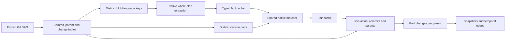

# DuckDB temporal ingestion evaluation

The alternative pipeline has accounted for every supported source key in the
frozen DuckDB history, processed all 496,163 distinct matching pairs, and
published 158,721,051 snapshot rows and 166,402,705 temporal edges through
bounded finalization. Its status is `completed_with_errors`: fourteen source
encoding failures remain explicit. Full-target structural, payload, fold and
edge checks passed, as did an exact bounded native oracle. Acceptance uses
explicitly composed evidence from frozen runs; it does not assert full-history
native row parity.
The bounded comparison establishes that
moving the work behind a DuckDB extension does not by itself beat the tuned
legacy walker.
The subsequent [producer concurrency evaluation](temporal-concurrency-evaluation.md)
reduces the source-stage midpoint from 94.82 s to 37.13 s on 1,987 commits and
adds two fresh four-producer pipelines with exact native graph parity. It
records separate timings and the native baseline's inter-session variation.

The frozen input is `8d3673cfd16c231f5e941386dec4c7744e7c21b6`. The scope is its
entire reachable DAG, including every merge parent, rather than first-parent
history. It contains 93,848 commits and 117,658 parent/root comparisons. Another
295 commits reachable only from other local refs are outside this frozen scope.

## Equivalent workloads

| Reachable commits | Serial CLI, no parse cache | CLI, 4 jobs, 64 MiB cache | Extension pipeline | Snapshots | Edges |
| ---: | ---: | ---: | ---: | ---: | ---: |
| 35 | 3.79 s | 2.33 s | 6.77 s | 35,742 | 37,386 |
| 372 | 23.34 s | 8.05 s | 17.33 s | 91,113 | 99,102 |
| 1,987 | 188.66 s | 63.82 s | 115.45 s | 550,720 | 614,805 |

The 372-commit figures are medians of three fresh-artifact runs. Other sizes
have one observation. All five extension runs passed exact schema and
bidirectional `EXCEPT ALL` comparisons of snapshots and edges, retaining
duplicates. Enriched commit rows also match exactly. Serial and tuned CLI
outputs match each other.

These observations used macOS ARM64, warm OS caches and fresh application
caches. Full-history activity overlapped the measurements. The extension
prefix controller used one parse producer at a time and recorded a DuckDB
default of ten threads; the four-job CLI used its own parser-worker concurrency.
These are approach-level observations, not an equal-concurrency engine test.
The extension persists pair shards and folded pointers and exposes native views; the legacy
runner writes flattened native Parquet. Validation-query time is recorded
separately. These observations do not isolate an engine-only speedup or compare
identical physical output layouts.

On 1,987 commits, the extension spent 0.89 s inventorying, 9.96 s preparing
metadata/plans, 94.51 s extracting source facts and 10.06 s deriving temporal
pairs. Peak stage RSS was 1.27 GB; the separate parity query peaked at 1.65 GB.
Source extraction dominates that fresh-cache workload. That stage combines
blob reads, native extraction and typed persistence; its timing does not
isolate parser CPU. The tuned legacy walker was faster at every size in these
original single-producer extension observations; the concurrency follow-up
measures the separate four-producer configuration.

gix is a separate semantic variant. Its 1,987-commit observation took 33.42 s,
but emitted 561,242 snapshots and 615,085 edges. Concrete differences include
rename versus delete/add classification and first-line versus folded-paragraph
commit summaries. Its speed cannot be presented as equivalent-output CLI speed.

## Full-history workload and output



| Quantity | Count |
| --- | ---: |
| File-change occurrences | 5,972,808 |
| Supported file-change occurrences | 4,009,505 |
| Logical old/new parse requests | 7,468,836 |
| Distinct `(blob_oid, language)` tasks | 257,316 |
| Distinct logical source bytes | 7,298,550,151 |
| Requested source bytes before reuse | 180,735,698,873 |
| Distinct temporal matching pairs | 496,163 |
| Extracted symbol facts | 17,160,066 |
| Successful empty source tasks | 8,286 |
| Source encoding errors | 14 |
| Binary inputs | 1 |
| Snapshot rows after the parent-scoped fold | 158,721,051 |
| Temporal edges, including file touches and rename edges | 166,402,705 |
| Diagnostic occurrences | 104,036 |
| Snapshot-key repetitions across different parents | 2,087,605 |

The final fold accounts for all 158,721,052 raw candidates, coalescing one
within-parent duplicate and preserving repetitions across parents. Pair
statuses are 496,133 completed, 28 parse failures and two binary skips. These
are distinct pairs; the source failures cover fourteen distinct source keys.
The output uses immutable pair payloads plus folded pointers and native-schema
views, rather than flattening 158 million full symbol/token rows into another
Parquet copy. Those dependent files must remain available.

The sole within-parent coalescence was inspected separately. In commit
`f5b068d1a3f4cc6cd76ba2d0066c1fd4b20e19b4`, a deleted method and an added
method in `physical_insert.cpp` have the same stable key but different
snapshots and ordered tokens. The legacy first-emission rule retains the
deletion payload and folds the conflicting kinds to `modified` with no previous
ID; the bounded output preserves that behavior. This is a legacy semantic
quirk, not evidence that the chosen payload represents the new method body.
The pair emits its deletion block before its addition block. Testing every
possible position of this deletion within that block preserved the first
payload and folded kind, so deletion-map iteration order cannot flip this
particular choice. The bounded probe used 188 MB RSS and no native reparse;
`single-coalescence-probe.json` records its inputs and evidence.

The workload offers 29.03 logical parse requests per distinct source key and
8.08 supported change occurrences per distinct matching pair. These are reuse
ratios, not end-to-end speedup measurements. C++ accounts for 233,143 parse keys
and 6.84 GB of distinct source bytes.

Bulk Git file-change inventory took 83.06 s and commit metadata took 1.15 s.
SQL import, validation, sizing and exports took 9.10 s. Git reported that its
default rename limit skipped exhaustive detection for some large changes; the
warning is retained. The pipeline therefore specifies Git CLI default
`--find-renames`, rather than claiming a stronger rename oracle.

Source extraction is complete with explicit terminal rows for every planned
key, including failures. The first 62,580-task persistent-cache partition took
1,637.33 s and peaked at 6.85 GB RSS. Three later shard partitions took
513.07–574.78 s for 59,301–68,173 keys and peaked at 0.73–1.11 GB. They contain
different inputs and use different producer versions; their times cannot be
combined into a uniform cold benchmark or attributed to one optimization.

Full pair derivation has 1,658 planned batches, 30.28 GB of logical old/new
pair input and 53 oversized singleton pairs. Byte budgets bound input bytes,
not AST, nested vectors or output memory. The current full run, final counts
and coverage receipt live under the evidence directory below.

## What the measurements explain

An exact generated ICU `stubdata.cpp` input, 37,869,027 bytes, took 1,647.84 s
in the original native extractor and produced zero symbols. A narrowly guarded
whole-file recognizer preserves that zero result for the exact generated
template. Three native trials took 0.417–0.472 s. Other C++ inputs still use the
normal parser. The old timing is one observation and background load differs;
this is evidence for that template, not a general C++ acceleration claim.

The next measured bottleneck is physical cache layout. The older source cache
stores 62,580 nested rows in one Parquet row group: 445 MB compressed and
1.424 GB uncompressed leaf data. The first matching batch needs only 46 keys
from it. One diagnostic batch spent 3.90 s loading facts and 0.15 s matching
them natively. Separate 1 GB and 3 GB bounded diagnostic queries failed while
loading nested payloads. Physical layout therefore needs its own memory and
lookup policy; a small logical source batch alone does not establish bounded
RSS.

An Arrow streaming rewrite completed in 11.26 s, peaked at 1.66 GB RSS and
produced 31 row groups occupying 270 MB. Exact Arrow equality compared all
62,580 full typed rows, including ordered nested lists and NULLs; native SQL
schemas and per-key full-row digest multisets also match. The token leaf changed
from plain encoding to dictionary/RLE encoding. A representative lookup read
50.96 MB and completed in 1.11 s with a 512 MB managed limit. Writer encoding,
row groups and background conditions differ, so this is a combined physical
rewrite observation rather than an isolated row-group speed ratio.

A matched ABBA replay used four fresh processes, two threads and a 3 GB managed
limit without spilling. The same 357-pair batch took 3.989–3.997 s with the
original cache and 0.621–0.630 s with the physical rewrite. Payload reads took
3.663–3.767 s versus 0.411–0.418 s; peak RSS was 1.62–2.03 GB versus
1.07–1.09 GB. Every expanded change row (11,096 per trial), ordered nested token
list, status, diagnostic and provenance field matched. Outer change-list order
varied even between original-cache trials because legacy deletion-map iteration
is randomized. The full run remained active during replay; these are matched
batch measurements, not a whole-history speed ratio.

The experiment cut over at 771 durable batches, preserving 245,454 pairs and
1,207,902,744 bytes of original pair shards. The original generation remains
explicitly interrupted and incomplete. The new generation keeps every original
semantic input descriptor and additionally binds the controller, configuration,
physical cache and exact equality receipt. Imported shards retain their bytes
through immutable hardlinks, after original checksum/schema/actual-ID checks.
Newly computed shards use ZSTD. Thirteen controller tests and independent review
cover drift, corruption, wrong IDs, source locking and mixed storage policies.
These changes are recorded as a resumed experiment, rather than one uniform
cold full-history benchmark.

All remaining 887 matching batches finished in 1,013.65 s of batch work. The
resumed process then failed in the global fold with a temporary-spill disk error;
its 1,658 pair shards remain intact. Its total process wall time was 1,067.70 s
and peak RSS 4.86 GB, including the failed fold. No completed graph is claimed
for that failed generation.

The physical query plan exposes a concrete wide intermediate: lateral `UNNEST ... WITH
ORDINALITY` introduces delimiter/hash state keyed on the entire nested change
list. Measured Parquet footers contain 29,314,796 distinct-pair change emissions,
9.23 GB of encoded-uncompressed change columns, including 8.55 GB of symbol
payload. These byte counts are file encoding measurements, not heap/RSS sizes.
The nominally narrow outer fold therefore still encounters a wide intermediate.
DuckDB's documented [SELECT-list unnest and subscript form](https://duckdb.org/docs/2.0/sql/query_syntax/unnest)
preserves list positions without that lateral delimiter/hash path. A real
11,096-emission shard and empty/NULL/list-position fixtures match exactly under
both forms; the replacement plan is a streaming UNNEST over the Parquet scan.
The exact occurrence expansion is 158,721,052 candidates; the maximum for any
whole commit is 160,435. Bounded numeric probes peaked at 247 MB RSS without
spilling. The failed attempt did not retain an operator-level profile, so the
evidence does not attribute its spill solely to the lateral state or final
group state.

The replacement finalizer streams each immutable pair shard into numeric thin
keys, then processes 1,072 complete-commit partitions, each containing at most
160,435 raw candidates. All parents of a commit remain together. Stable IDs
roundtrip through unsigned 64-bit integers, while commit and parent keys use
validated ordinals. The first emitted pointer supplies the snapshot payload;
nullable change-kind/previous-ID conflicts use an explicitly tested min/max
predicate. Full symbol and ordered-token payloads remain in the pair shards.
The output database exposes them through the folded pointers.

The finalizer uses one thread, a 384 MB managed limit and disabled spilling.
It checks actual output bytes and free disk before and after writes, retains
unreceipted files in quarantine, and verifies checkpoints before resuming.
Twenty-one fixture tests and independent review cover equivalence, corruption,
input drift, restart truth and disk admission. The first run stopped at its
512 MiB free-space reserve after 637 verified partitions: 96,423,222 folded
rows from 96,423,223 candidates, with 555 MB peak process RSS. Its checkpoints
were resumed in the same frozen generation. That second process returned
normally in 459.61 s, including re-verification of existing checkpoints and
the remaining fold work. Peak RSS reached 594.03 MB during final view/count
publication, above the approximately 457 MB observed near the end of folding.
The bounded generation occupies 2,398,955,197 bytes, excluding its immutable
source/pair dependencies. Managed memory is not a process RSS limit. These are
two resumed process observations, not one uninterrupted cold-ingestion timing.

The parser already processes whole blobs rather than parsing individual lines.
The data-engineering opportunity is to fetch and extract each distinct source
key once, preserve narrow metadata during joins, read nested facts only when
needed, and reuse matching results before expanding commit occurrences.
Independent shard workers can supply parser parallelism; their admission must
account for observed parser/output memory as well as source bytes.

The indexed [duck_tails implementation](https://github.com/teaguesterling/duck_tails/blob/main/src/git_log.cpp)
also iterates commits. `GitLogFunction` uses libgit2's revision walker and commit
lookup, fills a DuckDB chunk up to `STANDARD_VECTOR_SIZE`, and emits commit
metadata. The ordinary repository log path does not extract source ASTs or
match temporal symbols. The reported approximately three-second commit scan
has not been reproduced as an equivalent temporal workload here. Its useful
engineering pattern is persistent native Git state and chunked output, while
SPUR additionally needs content-addressed parse facts and parent-scoped matching.

## Adoption decision

Keep the native extension as the extraction/matching integration seam and
DuckDB as the query and storage layer. The current measurements do not justify
replacing the tuned walker on throughput grounds: at 1,987 commits the
extension takes 115.45 s versus 63.82 s for the four-job CLI, with equivalent
native facts. The practical wins are content reuse, inspectable intermediate
tables and resumable engineering of the large occurrence expansion.

The next performance comparison should use the same frozen target, process
concurrency and physical output contract, a uniform optimized extractor,
explicit memory/disk admission and fresh application caches. Separate the
source scan, parsing, matching, folding, validation and any flattened export.
The full experiment here changed producers and physical layouts while
resuming work; adding its phase times would not create that benchmark.

Use the measured physical cache layout and bounded fold alongside the SQL
extension for the full-history workflow. The promoted [bounded finalization
guide](bounded-temporal-finalization.md) describes its input and restart
contract. Parser parallelism
should follow measured per-input memory, including generated or oversized
sources. The 384 MB finalization setting does not describe the earlier parser
stages, whose measured process peaks were substantially larger.

## Correctness and reproducibility

The native matching scalar calls the shared legacy Rust matcher. Rename sides
use the current path's language. Final folds preserve parent identity, the
first snapshot payload and duplicate snapshots emitted for different parents.
The actual current commit is projected into both current and rename-predecessor
snapshot keys. Missing cache rows, successful empty results, binary skips and
parse failures remain distinct.

Original bulk commit metadata preserves author time (`%at`). Native CLI commit
rows use committer time (`%ct`), author name/email and `%s`. The canonical commit
sidecar covers all 93,848 OIDs with zero key/parent differences; 11,282 commits
have different author and committer times. This sidecar preserves both epochs.

The combined native extension passes all 50 Python/native integration tests.
The shared matcher and ICU recognizer also passed their focused Rust and
existing parser checks. The extension uses the pinned template revision
`a679601f8e133db7546777c6637bc7a6c2d2780e`, `duckdb-neo=0.20000.2`, and the
unstable C struct ABI for exactly DuckDB 2.0.0. Ordinary Parquet outputs remain
separate from native extension ABI compatibility.

The experiment was launched and inspected through Rust notebook cells in
`/Users/kevintruong/project/spur-notebook/duckdb-temporal-performance.ipynb`.
Its managed SQL runtime was preserved; Rust cells launched isolated native
DuckDB 2.0.0 processes.

The resume launch in cell016 failed before execution because a generated
tree-sitter include was missing. Restoring the exact bytes copied by that
dependency's build script recovered Rust evaluation without a kernel restart.
The identical pinned finalization bootstrap was resumed through a recorded
terminal fallback, and cell017 saved its live status.

The canonical `native_commits` view was published successfully for all 93,848
commits through Rust cell019. The first read-only validation attempt passed
114 checks before its metadata-fingerprint phase reached 525,598,720 bytes RSS
and exceeded its 512,000,000-byte process ceiling. It reported no semantic
discrepancy before stopping. The adapted verifier uses fixed-vector exact
metadata comparisons, isolated query workers, ordered identity checks,
complete-commit ownership ranges and an exact dictionary of 339 logical
filenames. Query requests are sequential; receipt streaming can keep another
worker alive, so the ceiling applies per process rather than to aggregate RSS.

The frozen `b20e52b9...165a6` verifier then passed all 203 checks before its final
oracle payload fetch exceeded that ceiling at 573,538,304 bytes. That invocation
took 2,049.89 s and remains explicitly failed. Its successful checks cover all
4,009,505 ownership rows, all 1,658 pair shards and 29,314,796 emissions, all
1,072 folds and 158,721,052 candidates, parent multiplicity, complete edge and
diagnostic accounting, endpoint/parent contracts and representative queries.

A frozen per-pair oracle supplement completed through Rust cell022 in 15.69 s.
All 2,087 derived rows exactly match the native rows for 32 selected commits,
including 15 zero-symbol requests, 36 pairs, ordered tokens and parent-specific
multiplicities. Missing and extra row counts are both zero. Nine focused
regressions cover source mutation, prior semantic failure and oracle corruption.
The supplement hashes 13.01 GB in two passes over retained unique inodes,
checks pre-audit file contexts and original descriptors under shared locks,
and rechecks saved schemas, view SQL and publication/status evidence. The old
database digest was unavailable: its retention basis explicitly uses pre-audit
mtime/ctime and previously saved schemas/views, with a current digest and
before/after rechecks, rather than inventing a prior digest.

`validation-composed.json` says `passed: true`, `evidence_mode: composed`. It
binds the unchanged partial report and both controller hashes, accepts its 203
successful checks, and replaces only the oracle resource stop. Accepted prior
workers peaked at 486.16 MB; the supplement peaked at 181.47 MB. The old failed
573.54 MB invocation remains visible. These are verification measurements,
separate from ingestion timings. Symbol content is still incomplete for the
documented parse/binary inputs; composition does not turn them into successes.

## Querying the result

Open the completed `temporal.duckdb` with DuckDB 2.0.0 in read-only mode and keep
its referenced files in place. The thin pointers support history aggregation
without fetching all symbol/token payloads:

```sql
WITH churn AS (
    SELECT commit_oid, count(*) AS symbol_touches
    FROM folded_pointers
    GROUP BY commit_oid
    ORDER BY symbol_touches DESC
    LIMIT 10
)
SELECT c.sha, c.author_time AS native_committer_epoch, c.summary,
       churn.symbol_touches
FROM churn JOIN native_commits c ON c.sha = churn.commit_oid
ORDER BY churn.symbol_touches DESC;
```

This query took 3.74 s in the validation observation, peaking at 186 MB RSS.
Its largest result is merge `db850074612a9ba4726715269d64a31ed28a9bf7`, with
160,435 parent-scoped symbol touches. The full coverage checks found one root,
23,810 merge commits, 312 commits without file changes and 14,362 commits
without emitted symbol rows. These commits remain present in the commit table.

Local evidence root:
`docs/research/artifacts/2026-11-14-duckdb-full-temporal/`.

Important receipts include `workload-summary.json`, `all-source-extraction.json`,
`pair-batch-plan.json`, `legacy-comparison/backend-parity.json`,
`extension-comparison/verification.json`, `canonical-commits.receipt.json`,
`icu-native-comparison.json`, `cache-layout-analysis.json` and
`duck-tails-source-evidence.json`, `cache-layout-pilot-proof.json`, `cutover.json`
`physical-read-cache-independent-review.json` and `paired-batch0-replay.json`.
Controllers and native-tool hashes are
retained beside the data. Large raw and Parquet artifacts are local research
evidence rather than source-control payloads.

The completed bounded generation is
`bounded-finalization/gen-bc853abe1fda93d739d00aae8440c5b079e172a0c79284639381f1bcf1511714/`
under that evidence root. Its `inputs.json`, `plan.json`, `current-status.json`,
`result.json`, `native-commits-publication.json`, `receipts/` and
`temporal.duckdb` bind the completion evidence. The controller, plan and resource
configuration are retained as `bounded_temporal_finalize.py`,
`bounded-finalization-plan.json` and `bounded-finalization-config.json`.
The two process resource receipts are named
`bounded-finalization-resources-<generation>-25773.json` and
`bounded-finalization-resources-<generation>-39372.json`.

The final acceptance receipt is `validation-composed.json`, SHA-256
`b9fbb2eb5b93046688533a8088dded93b00232e7af62952aa7a9e3d080b7713c`.
Its immutable partial report is
`validation.partial-b20e-1a6ed280b257cd8f8a1a38869e110cb824f18ef1ac241724498b2d6c43329535.json`.
The frozen controllers are `validate_full_temporal.frozen-b20e52b98f6b3fe9dfc2f9c2503408b9c032d1d133e7e08ea48cc95fe37165a6.py`
and `validate_temporal_oracle_supplement.frozen-d0501bc9d926610a1862a092b5bfbd5d730d2630ce6109f8199bf3e019de57d1.py`.
Their tests, probes and stdout/stderr are retained beside them. The historical
`validation.json` and earlier failed reports remain failed; use the composed
receipt for final acceptance. `final-accounting-solve.json` verifies four exact
integer accounting balances, not the whole program.

The legacy comparison stops at 1,987 commits; full-target outputs come from the
alternative pipeline. There is no full-versus-full runtime or row-multiset
parity claim.
