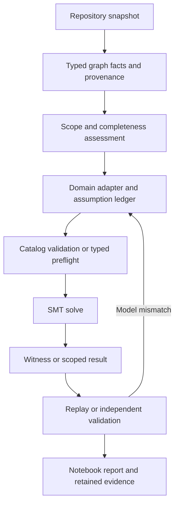

# Spur Graph × Symbolic Engineering

Research assessment · 24 October 2026

**Recommendation: pursue the combination as an evidence-grounded constraint workbench.** The graph can locate and explain relevant engineering facts; the solver can check compatibility, construct witnesses, and optimize bounded choices. The largest opportunity is a reliable translation between those layers, with every conclusion tied to its inputs and scope.

In this repository, the implementation called “spur-solve” in the question is the `spur-solver` crate and its `solve_*` tools. “Graph engineering” and “symbolic engineering” are useful product descriptions here, rather than formal names for two standardized disciplines.

**Decision:** invest first in a small, auditable graph-to-constraint adapter for explicit configuration, policy, or workflow facts. General verification of arbitrary source code requires substantially richer program semantics and additional validation.

## 1. Scope and evidence

This assessment combines current source inspection, live catalog discovery, two executed solver experiments, and a targeted review of ten primary research or official documentation sources. It is an architectural research document, not a performance benchmark or an exhaustive survey of the latest literature.

| Evidence | Boundary |
|---|---|
| Source repository | `/Users/kevintruong/project/SpurCode` |
| Inspected HEAD | `b16aa9c55f08f3a241d31890253bfe27eba0a471` |
| Precise graph artifact | `4720925b48d72351dda9beb885921e2ae709aa9e9709c4eb898d1e77a8ae6155` |
| Precise source checks | Subsequent symbol queries reported matching file OIDs and matching indexed/worktree HEADs; selected findings were checked against working-tree bytes |
| Live solver | Reported `Z3 version 4.16.0 - 64 bit`; its host binary was not independently tied to the inspected source commit |
| Literature | Primary papers, author/institution pages, and official tool documentation; accessed 24 October 2026 |
| Validation performed | Source/schema inspection and two bounded catalog solves; no Rust build, full test suite, or production defect replay |

An evidence-routing discrepancy occurred during research: `knowledge_context_pack_2`, including a request with `project: spurcode`, returned notebook-project paths and graph hash `1c67d4f1ea031c580b2236b7426ec6a4090df94bd737f504cadc0940c5ac48ce`. Precise `code_*` calls with the same registered project returned SpurCode files and the artifact hash above. The orientation results were excluded from implementation conclusions. This is an observed context inconsistency; its root cause was not diagnosed.

Claims below are labeled by context: **observed** means source or tool evidence; **inference** means the interpretation of that evidence; **proposed** means work that has not been implemented or evaluated here.

## 2. What already exists

| Layer | Observed capability | Practical boundary |
|---|---|---|
| Graph extraction and schema | Tree-sitter dependencies; typed symbols and relations; source spans; optional unresolved targets; receiver/scope text and binding method | The source explicitly describes scope evidence as syntax-first, without compiler-grade semantic certainty |
| Graph provenance | Content hashes, file manifests and content OIDs, index pointers, commit and symbol snapshot types | Freshness of returned files does not establish that all relevant files or behaviors were included |
| Graph relations | Imports, calls, constructs, containment, implements, defines, references, extends, links, touches, produces, consumes, binds, emits | The inspected `RelationKind` enum does not provide a Joern-style control-flow or reaching-definition relation layer |
| Confidence | `SyntaxExact`, `Heuristic`, `Unknown`, plus a numeric score and binding provenance | A confidence score does not prove semantic correctness or completeness |
| Solver | Typed constraints, validation, SMT encoding, Z3 execution, named hard constraints, optimization and bounded collection | The service checks the submitted formula; it does not establish that the formula accurately models the program |
| Rule catalog | Eight implemented families: accessibility, configuration, data integrity, design, policy, resource, scheduling, workflow | Domain facts and unknowns must be supplied explicitly; each call selects one family |
| Interpretation | Jev can return an open/blocked gate, candidate family request, and provenance | Candidate interpretation is separate from solver validation and proof |
| Result persistence | `SolveArtifact` stores request, solver version, result, timestamp, and solve ID | Its top-level schema has no graph snapshot identity, extraction coverage, or source-to-constraint map |

Source anchors: [graph schema](../../crates/spur-graph/src/schema.rs), [graph dependencies](../../crates/spur-graph/Cargo.toml), [solver request/result types](../../crates/spur-solver/src/types.rs), [solver service](../../crates/spur-solver/src/service.rs), [family execution](../../crates/spur-solver/src/rules/execute.rs), [persistence](../../crates/spur-solver/src/persist.rs), and [Jev compilation](../../crates/spur-jev/src/mcp.rs).

The inspected solver manifest has no direct dependency on `spur-graph`. The composition layer exposes solver services alongside other tools. This supports a modular architecture, but co-exposure of tools is not evidence of an automated semantic bridge. No first-class graph snapshot binding was found in the inspected solver request, artifact, or family execution paths. An adapter elsewhere cannot be ruled out by this bounded review.

Some older design documents describe features such as Pareto/box optimization and sessions as deferred. Current request types and service code include them. This report gives current source precedence over those historical plans.

## 3. Cross-check against research and industry practice

The two underlying ideas have substantial precedent. The integration, developer workflow, and evidence quality are the plausible differentiators. These sources support design principles; none establishes that Spur already matches their correctness or scale.

| Primary source | What it establishes | Implication for Spur — assessment |
|---|---|---|
| [Joern Code Property Graph specification](https://cpg.joern.io/) | A layered code representation includes syntax, control flow, and program dependence | Reuse the principle of typed, composable semantic layers. Spur's current relation schema should not be described as equivalent to a complete CPG |
| [GitHub CodeQL: data flow analysis](https://codeql.github.com/docs/writing-codeql-queries/about-data-flow-analysis/) | Value-flow semantics differ from syntax-tree structure; analyses model runtime value propagation | A call edge alone cannot establish a taint path, guard condition, or feasible execution |
| [de Moura and Bjørner, Z3, TACAS 2008](https://www.microsoft.com/en-us/research/publication/z3-an-efficient-smt-solver/) | SMT supports reasoning over combinations of background theories | The backend is well grounded in research; source extraction and domain encoding remain separate engineering obligations |
| [Clarke et al., CEGAR, CAV 2000](https://www.cs.cmu.edu/~emc/papers/Conference%20Papers/Counterexample-guided%20Abstraction%20Refinement.pdf) | Over-approximating models can admit spurious counterexamples; refinement uses them to improve the abstraction | Validate a witness against source/runtime, then refine the model. Arbitrarily retrieving fewer graph nodes is not sound abstraction refinement |
| [Cadar, Dunbar, and Engler, KLEE, OSDI 2008](https://www.usenix.org/legacy/event/osdi08/tech/full_papers/cadar/cadar_html/paper.html) | Symbolic execution can generate concrete tests; the work includes replay against native programs | Turn candidate witnesses into reproducible tests when feasible. Spur currently exposes constraint solving, which alone does not constitute a symbolic execution engine |
| [Disselkoen et al., Cedar, FSE 2024](https://www.amazon.science/publications/how-we-built-cedar-a-verification-guided-approach) | Verification-guided development combines a proved executable model, differential random testing, and property-based testing | Test the adapter and runtime correspondence, as well as the solver encoding. The model/implementation gap is a central concern |
| [Meta Infer engineering report, 2015](https://engineering.fb.com/2015/06/11/developer-tools/open-sourcing-facebook-infer-identify-bugs-before-you-ship/) | Modular reasoning and bi-abduction support practical static analysis | Prefer bounded components and reusable summaries over an attempt to solve a whole repository in one formula |
| [Soufflé official documentation](https://souffle-lang.org/docs/home/) | Datalog is used to construct static analyses over relational facts | Keep large relational closure and graph filtering in a suitable query layer; reserve SMT for the decision constraints that require it |
| [Edge et al., GraphRAG, 2024](https://www.microsoft.com/en-us/research/publication/from-local-to-global-a-graph-rag-approach-to-query-focused-summarization/) | Entity graphs and community summaries improve a class of global document questions | Use graph-assisted language models for discovery and explanation. The study does not validate formal program-correctness claims |
| [Apalache: symbolic model checking](https://apalache-mc.org/docs/tutorials/symbmc.html) | Transition systems and symbolic traces give a precise basis for bounded exploration | State the domain, transition relation, and horizon beside every workflow result |

**Research judgment:** the combination is technically credible. A claim of novelty should focus on a measured, source-linked engineering loop rather than on combining graphs and logic in the abstract. Comparative evaluation is still needed.

## 4. The central correctness condition

There are four different questions:

1. **Discovery:** what source or relationship may matter?
2. **Extraction:** what precisely does that source establish?
3. **Modeling:** what assumptions and semantics connect the extracted facts to constraints?
4. **Solving:** what follows from that exact constraint system?

Success at step 4 cannot repair an error in steps 1–3. A fresh graph can still be incomplete; a fully satisfiable formula can still encode the wrong requirement.

For a bounded safety claim, let `T_real(k)` be the real traces up to horizon `k`, and `T_model(k)` the modeled traces. If the model covers every relevant real trace and preserves the meaning of “bad,” then:

`T_real(k) ⊆ T_model(k)` and `no modeled bad trace` imply `no real bad trace within k`.

An under-approximation, such as a graph slice that drops a reachable branch, has the opposite containment direction. Its lack of a counterexample does not establish safety of the omitted behavior. An over-approximation can support a safety conclusion within its domain, while its positive witnesses may require concretization. This application follows the abstraction principle described in [CEGAR](https://www.cs.cmu.edu/~emc/papers/Conference%20Papers/Counterexample-guided%20Abstraction%20Refinement.pdf).

| Query | `sat` means | `unsat` means |
|---|---|---|
| Catalog `verify` | Supplied complete facts pass the selected rules | Supplied facts fail at least one selected rule |
| Catalog `synthesize` | A feasible assignment exists | No assignment exists under these facts and bounds |
| Counterexample search | A violating modeled input or trace exists | No violating input or trace exists in this model/domain |
| Optimization | Inspect objectives, bounds, and termination before claiming an optimum | Hard feasibility may have failed; interpret the exact response |

`unknown`, `timeout`, `error`, and `ended` establish neither success nor impossibility. Bounded workflow results establish neither unbounded liveness nor fairness. The mode mapping is implemented in [family execution](../../crates/spur-solver/src/rules/execute.rs); workflow bounds are represented in [evaluation scope](../../crates/spur-solver/src/rules/compiler.rs).

## 5. Proposed architecture

Keep graph extraction, domain interpretation, and solving separately testable. Introduce a narrow adapter that produces a versioned evidence bundle before executing a request.

This diagram is proposed. The source-to-model and replay stages are the principal development work.

| Proposed bundle field | Purpose |
|---|---|
| Repository identity, commit, dirty-content digest | Prevent mixing projects, revisions, or uncommitted source states |
| Graph content hash and schema/extractor version | Identify the exact graph and extraction semantics |
| File OIDs, symbol IDs, source spans | Make each selected fact inspectable |
| Binding method and evidence class | Distinguish exact syntax, inferred relationships, and explicit assumptions |
| Scope description and coverage result | Record queried modules, entrypoints, unresolved edges, excluded files, truncated frontiers, and the treatment of unknowns |
| Abstraction direction | Declare exact finite model, conservative over-approximation, under-approximation, or unestablished correspondence |
| Constraint-to-evidence map | Link every named constraint to source facts, rule versions, and transformation steps |
| Assumption ledger and domain bounds | Expose closed-world assumptions, integer/bit-vector choices, units, overflow, and workflow horizons |
| Exact family request and compiled request | Preserve both domain meaning and backend input |
| Solver version, status, model/core, objectives | Retain the unmodified solver answer and its interpretation |
| Validation outcome | Record replay, differential checking, and source changes that invalidate reuse |

This bundle should wrap existing services first. A new dependency from `spur-solver` to the whole graph stack is not required merely to carry provenance. The top-level persisted request is currently the generic solver request; [family execution](../../crates/spur-solver/src/rules/execute.rs) compiles family input before handing it to the service. Therefore preserve the original family request and rule/projection mapping explicitly in any new research or handoff artifact.

**Proposed conclusion categories:** verified for a declared model; candidate counterexample awaiting replay; confirmed counterexample; conditional on assumptions; inconclusive; stale. Keep the original solver status alongside these categories.

## 6. Executed experiment: a missing branch changes the answer

**This is a synthetic illustration, not a discovered Spur production bug.** The facts were authored explicitly; they were not extracted automatically from code. The experiment exercises the live catalog workflow path and demonstrates a model-completeness failure mode.

Question: can `Unsafe` be reached from `Request` within two transitions?

Both requests selected `workflow.initial_state_allowed`, `workflow.transition_allowed`, and `workflow.bounded_reachability`, with synthesis mode, horizon 2, reachability bound 2, and four declared unknown slots. No safety rule was asserted: doing so would suppress the unsafe witness being sought.

| Input graph/model | Declared transitions | Observed result | Valid interpretation |
|---|---|---|---|
| Incomplete slice | `Request → Guarded → Safe` | `unsat`, `infeasible`; 27 ms solver-service duration, 29 ms total | No unsafe witness in the supplied slice and horizon |
| Expanded finite model | Same path, plus `Request → Bypass → Unsafe` | `sat`, `solution`; 7 ms service/total | Unsafe witness exists in this declared model |

The returned witness was `Request --skip--> Bypass --publish--> Unsafe`. The first result returned an unsat core containing the transition rule and target-reachability rule. Both runs reported Z3 4.16.0 and explicit bounded-trace scope.

The timings are single observations and cannot support a speed comparison. The larger model happened to finish sooner; this is not evidence of a scaling trend.

**Finding:** the solver did its job in both runs. The dangerous mistake would be presenting the incomplete slice's result as a repository-wide guarantee. The proposed integration must decide whether the selected evidence supports the scope of the requested conclusion.

Exact requests and complete returned envelopes, including generated SMT, are included in the notebook appendix and the companion JSON evidence file. `persist: false` was used; these runs do not have persisted solve IDs.

## 7. Gaps to address, in priority order

| Priority | Finding | Recommended response |
|---|---|---|
| P0 | Project/snapshot identity can diverge across retrieval surfaces, as observed during this investigation | Assert repository identity and snapshot consistency at the adapter boundary; reject mismatched evidence before modeling |
| P0 | Graph-to-model completeness is not established by the inspected solver contract | Require an explicit coverage result and abstraction claim; block broad safety conclusions when correspondence is unknown |
| P0 | Syntax-based bindings may be heuristic or unresolved | Retain uncertainty. For safety analysis, soundly model possible targets or mark the claim inconclusive; deleting uncertain edges can create false confidence |
| P1 | Source and constraints are not automatically linked in the inspected artifact schema | Add named-constraint provenance and assumption records to a versioned wrapper |
| P1 | Current relation schema does not itself capture branch guards, path feasibility, memory aliasing, and language execution semantics | Start with explicit configuration/workflow models; add compiler/IR-backed semantic extraction only for selected code-analysis tasks |
| P1 | Solver witnesses are not automatically confirmed runtime behaviors | Add test generation or a finite-model interpreter for replay, keeping candidate and confirmed outcomes distinct |
| P1 | Limits force decomposition | Source declares 64 variables, 256 constraints, and a 60-second maximum timeout; design compact projections and summaries before increasing caps |
| P2 | Identity and cache reuse need source-sensitive invalidation | The basic symbol-ID function includes path, qualified name, kind, and starting byte offset. Pin source hashes and use temporal mapping where available rather than assuming IDs survive arbitrary edits |

These are integration requirements and observed schema boundaries, not assertions that every item is an existing defect. The ID construction is visible in [identity.rs](../../crates/spur-graph/src/identity.rs), limits in [types.rs](../../crates/spur-solver/src/types.rs), and provenance fields in [schema.rs](../../crates/spur-graph/src/schema.rs).

## 8. Best initial use cases

| Use case | Why it fits | Required evidence | Priority judgment |
|---|---|---|---|
| Configuration compatibility | Selection, version ranks, and allowed combinations are explicit finite facts | Complete component inventory and declared compatibility rules | Best first pilot |
| Deployment/resource planning | Capacity and topology constraints already have catalog families | Snapshot of demands, capacities, failure domains, and units | Strong second pilot |
| Policy review | Finite role/permission facts are amenable to bounded analysis | Complete declared principal/role scope and policy semantics | Strong, with careful scope controls |
| Workflow/state-machine review | Transition tables and bounded witnesses map directly to current rules | Complete finite transitions, horizon, terminal/stuttering semantics | Good demonstration and engineering use case |
| Change-impact-assisted test selection | Graph can identify likely affected components; optimization can choose a bounded test set | Validated coverage relations and explicit budget | Useful recommendation; not a completeness guarantee without stronger evidence |
| Arbitrary code safety/security proof | Requires control/data flow, call resolution, environment and memory semantics | A validated semantic frontend and a defined language subset | Later research, not the initial promise |

Graph computation should answer reachability and relational discovery when those operations suffice. Solver calls add value when the question requires choices, conflicting constraints, arithmetic bounds, or optimization. This division is an architectural recommendation, informed by the relational-analysis role of [Soufflé](https://souffle-lang.org/docs/home/) and the theory-solving role of [Z3](https://www.microsoft.com/en-us/research/publication/z3-an-efficient-smt-solver/).

## 9. Evaluation design

**Hypothesis H1:** graph-scoped, source-linked constraint solving improves correct engineering decisions relative to retrieval-only and manually supplied solver workflows, at an acceptable cost. This remains untested on real tasks.

Use the same task set, source snapshots, model, and budget across four conditions:

1. Language model with ordinary text retrieval.
2. Language model with graph retrieval.
3. Language model with constraint tools and manually prepared facts.
4. Graph retrieval plus a deterministic adapter, constraint tools, and replay.

Stratify tasks by explicit configuration, finite workflows, policy, and code-derived facts. Include negative controls: missing edges, ambiguous call targets, stale files, mismatched projects, contradictory requirements, and timeout cases. Keep real defects separate from seeded mutations. Split by repository or time to reduce leakage from near-duplicate tasks.

| Measure | What to report |
|---|---|
| Decision correctness | Confirmed defects/valid solutions and incorrect claims, with a declared ground-truth process |
| Unsafe assurance rate | Fraction of clean/safe claims contradicted by ground truth, including missing-evidence cases |
| Counterexample quality | Candidate count, replay success rate, and reasons candidates fail |
| Fact quality | Resolution precision/recall against annotated fixtures and compiler-derived references where applicable |
| Provenance coverage | Fraction of emitted constraints with source or explicitly declared assumption links |
| Robustness | Behavior under stale, incomplete, ambiguous, and conflicting inputs |
| Cost | End-to-end p50/p95 latency, model tokens, graph query time, compilation time, solve time, memory, and timeout rate |
| Developer usefulness | Time to understand and validate a result; whether the evidence identifies an actionable location |

Report per-domain results and uncertainty intervals, not just an overall average. Choose sample size after a pilot establishes effect size and variance. Do not treat zero failures on a small sample as a universal correctness claim.

**Proposed release gates:** all stale/mismatched/incomplete fixtures produce appropriately limited conclusions; every reported constraint has an evidence or assumption link; candidate witnesses are clearly distinguished from replayed ones; and the combined system demonstrates a predeclared improvement over graph-only retrieval on held-out tasks. Numeric performance targets should be set before the held-out evaluation, using measured baselines rather than invented thresholds.

## 10. Staged development recommendation

| Stage | Deliverable | Exit evidence |
|---|---|---|
| A — Contract | Evidence-bundle schema, explicit status interpretation, project/snapshot checks | Adversarial fixtures cannot produce an unsupported broad guarantee |
| B — One adapter | Deterministic configuration or finite-workflow extraction with a source-to-constraint map | Independent interpreter/validator agrees with generated models on bounded fixtures |
| C — Developer loop | Notebook view of facts, assumptions, witness/core, and source links; invalidation after edits | A reviewer can reproduce the result from the retained request and evidence |
| D — Comparative evaluation | Four-condition study from Section 9 | Measured quality/cost advantage on held-out tasks |
| E — Broader semantics | Selected compiler/IR-backed control/data-flow or interprocedural summaries | Per-language soundness scope and replay results justify the expanded claim |

Cedar's model/implementation testing approach is especially relevant to Stage B: its authors describe combining formal model reasoning with differential and property-based testing. Spur can adopt that validation pattern without claiming Cedar-equivalent verification. [Cedar, FSE 2024](https://www.amazon.science/publications/how-we-built-cedar-a-verification-guided-approach).

**Recommended positioning:** “Spur connects source evidence to explicit engineering constraints and returns inspectable, scoped results.” The strongest defensible product story is a reproducible decision workflow. A claim that arbitrary code is proven correct would exceed the evidence in this review.

## 11. Source map and reproducibility

The links below are relative to this document and its sibling notebook. Line numbers refer to the inspected revision; they are included as navigation hints rather than permanent identities.

| Local evidence | Relevant location |
|---|---|
| Graph artifact, file manifests, snapshot pointer | [schema.rs](../../crates/spur-graph/src/schema.rs), lines 78, 123, 139 |
| Edge evidence and binding provenance | [schema.rs](../../crates/spur-graph/src/schema.rs), line 174 |
| Relations and confidence | [schema.rs](../../crates/spur-graph/src/schema.rs), lines 322 and 459 |
| Symbol identity inputs | [identity.rs](../../crates/spur-graph/src/identity.rs), line 35 |
| Incremental artifact entrypoint | [store/build.rs](../../crates/spur-graph/src/store/build.rs), line 374 |
| Generic request, limits, and result envelope | [types.rs](../../crates/spur-solver/src/types.rs), lines 12, 536, 994 |
| Solve/cache/session/encoding path | [service.rs](../../crates/spur-solver/src/service.rs), line 252 |
| Family compile and mode interpretation | [rules/execute.rs](../../crates/spur-solver/src/rules/execute.rs), lines 41, 65, 166 |
| Explicit workflow evaluation scope | [rules/compiler.rs](../../crates/spur-solver/src/rules/compiler.rs), line 94 |
| Persisted request/result contract | [persist.rs](../../crates/spur-solver/src/persist.rs), line 234 |
| Jev interpretation gate | [spur-jev/src/mcp.rs](../../crates/spur-jev/src/mcp.rs), line 88 |
| Solver registry composition | [spur-core/src/mcp/mod.rs](../../crates/spur-core/src/mcp/mod.rs), line 131 |

To reproduce the demonstration, navigate `solve_rule_spec` for `workflow.bounded_reachability`, then submit the two exact requests in the appendix to `solve_rules`. Compare status, scope, and the decoded witness; do not assert exact timings. The observed results are retained in [the evidence JSON](2026-10-24-spur-graph-symbolic-engineering-evidence.json).

The ten external references in Section 3 are the literature basis. The recommendations, proposed contract, prioritization, and evaluation plan are this assessment's synthesis. No cited source has evaluated Spur itself.
