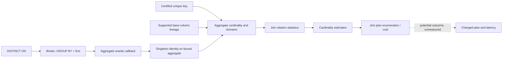

# DuckDB PR #28731: four-view review simulation

The simulation can answer the four review questions with a bounded evidence set. It does **not** establish that the current Code Graph Workbench already provides this workflow. Native extraction and historical analysis work together; repository linking, change normalization, current review context and human navigation remain substantial app capabilities.

[Live notebook](/Users/kevintruong/project/spur-notebook/2026-11-17-duckdb-pr-28731-review-simulation.ipynb) · [Frozen evidence](artifacts/2026-11-17-duckdb-pr-28731/) · [Previous rebuilt-extension/app audit](2026-11-17-spur-graph-explore-experience-audit.md).

## Scope and actual execution

Target: [Preserve aggregate domains for proven singleton groups](https://github.com/duckdb/duckdb/pull/28731), open at capture time. Base `629e395a854d72dcb1f414e1a0451c68ac0e9f1f`; head `d29b26bb92ac940a0807be0f43cc385b31623839`. At initial capture, the clean local DuckDB checkout matched the PR head. During final verification it had moved to `8335b7bed5df5ac4415ac9163210b2e37120cedc` and remained clean. All extraction, history and source evidence uses explicit immutable base/head SHAs, so checkout drift does not change the review snapshot. GitHub reports three commits, five files, +603/−3.

The notebook actually loaded **DuckTails v1.9.0** and the rebuilt **spur_graph 0.1.0** artifact together on **DuckDB 2.0.0**. “2.0” here identifies the runtime/API target; the extension's reported package version remains 0.1.0.

Executed in the managed notebook kernel:

- DuckTails base/head diff: five files.
- Spur Graph symbol and diagnostic file-facts extraction: both changed C++ files at both revisions, all four statuses `ok`.
- 65 historical rows across the two implementation files, with explicit base revision and author-date lower bound 2026-05-21, capped at 40 rows per file. Returned counts: 37 and 28.
- 158 base-region blame lines: 42 around the ordered rewrite and 116 around existing aggregate statistics.
- A co-change sample of the 12 most recent distinct history commits, excluding four merges, leaving eight single-parent commits.
- Six SQL result views covering changes, propagation, architecture, stakeholder context, blame and historical test candidates.

No DuckDB PR build, SQL regression suite or performance benchmark was run in this simulation. Measurements and tests in the PR description remain author-reported.

## 1. Impact and blast radius

The direct change is concentrated:

| File | Change | Review significance |
|---|---:|---|
| first_last_any.cpp | +2 | Carries singleton identity through ordered aggregate rebinding |
| relation_statistics_helper.cpp | +140/−3 | Proves singleton groups and forwards eligible aggregate domains |
| distinct_on_stats_propagation.test | +462 | Positive and conservative-fallback regressions |
| stats_dependent_tests.json | +1 | Statistics-sensitive test configuration |
| verify_aggregate_state_export.json | +1 | Aggregate-state export verification configuration |

Native extraction and exact body comparisons identify five semantic production function seeds:

1. `RewriteOrderedFirst`: modified.
2. `GetValuePreservingColumn`: added.
3. `HasBaseColumnSource`: added.
4. `HasUniqueGroups`: added.
5. `ExtractAggregationStatsInternal`: modified.

The raw extractor yields six changed-function candidates because `RewriteOrderedFirst` has overlapping template-wrapper and function representations with different scopes. The simulation collapses only the contained representation for presentation and preserves raw spans, scopes and source hashes. This is a concrete normalization gap. It does not repair the separate ordinary-symbol matching defect documented in the previous audit.

The behavioral scope is broader than DISTINCT ON: eligible scalar identity aggregates, including min/max, can use these guards. The intended downstream effect is on distinct-count domains, cardinality estimates, join cost and potentially plan choice. The source establishes a structural path; execution frequency, actual changed plans and performance require runtime experiments.

The crucial boundary is exact evidence of unique groups. Immediate primary keys and qualifying not-null UNIQUE constraints can prove singleton grouping. Nullable/deferred constraints, incomplete keys, lossy or TRY casts, multiplying joins and unsupported lineage remain conservative. Aggregate FILTER, list overloads and ordinary nullable-selector arg_min/max remain outside the domain-forwarding condition. Cardinality preservation and domain forwarding have different guards and must be explained separately.

The original unconstrained CTAS workload in [issue #28615](https://github.com/duckdb/duckdb/issues/28615) remains outside the fix. A review dashboard must keep that limitation beside the change summary.

## 2. The propagation graph

Source anchors at the pinned head:

- [PlanDistinct](https://github.com/duckdb/duckdb/blob/d29b26bb92ac940a0807be0f43cc385b31623839/src/planner/binder/query_node/plan_query_node.cpp#L128) binds first(payload) during lowering.
- [BindFirst](https://github.com/duckdb/duckdb/blob/d29b26bb92ac940a0807be0f43cc385b31623839/src/function/aggregate/distributive/first_last_any.cpp#L517) registers rewrite/identity metadata; the [changed rewrite](https://github.com/duckdb/duckdb/blob/d29b26bb92ac940a0807be0f43cc385b31623839/src/function/aggregate/distributive/first_last_any.cpp#L57) copies identity onto the rebound aggregate.
- [Unique-group proof](https://github.com/duckdb/duckdb/blob/d29b26bb92ac940a0807be0f43cc385b31623839/src/optimizer/relation_statistics/relation_statistics_helper.cpp#L513) and the [domain-transfer guard](https://github.com/duckdb/duckdb/blob/d29b26bb92ac940a0807be0f43cc385b31623839/src/optimizer/relation_statistics/relation_statistics_helper.cpp#L661) qualify the new behavior.
- [RelationManager](https://github.com/duckdb/duckdb/blob/d29b26bb92ac940a0807be0f43cc385b31623839/src/optimizer/join_order/relation_manager.cpp#L623) consumes aggregate statistics. [CardinalityEstimator](https://github.com/duckdb/duckdb/blob/d29b26bb92ac940a0807be0f43cc385b31623839/src/optimizer/join_order/cardinality_estimator.cpp#L987) consumes domains; [PlanEnumerator](https://github.com/duckdb/duckdb/blob/d29b26bb92ac940a0807be0f43cc385b31623839/src/optimizer/join_order/plan_enumerator.cpp#L200) uses estimates and cost.

The saved evidence map contains 20 inspected source points and 16 typed relationships, including 14 source paths, one inferred eligibility relationship and one explicitly unproven shared-property candidate. These are **not** automatic whole-repository blast-radius counts.

The keyed recursive CTE operator reads the same metadata property. No path from the changed bound aggregate expression into that consumer was established. It belongs in an optional regression-candidate layer, with no confirmed-impact badge.

The repository graph is indexed at `b678afa97b529d5856731e115e31542a72d2d978`, not the PR head. Its file OIDs fail freshness matching, and its temporal tables contain no commit/snapshot/temporal-edge records. Graph navigation was useful for orientation; all displayed propagation claims were checked against pinned Git source. Zero temporal rows mean history is unavailable from that graph, not that the code has no history.

## 3. Architecture perspective

| Component | Role in this PR | What a reviewer should inspect |
|---|---|---|
| SQL planning | Unchanged entry context | DISTINCT ON lowering into groups and first(payload) |
| Aggregate binding/rewrite | Direct change | Ordered rewrite preserves singleton identity; overload/serialization boundaries |
| Uniqueness and lineage proofs | New guards reuse existing proof machinery | Exact keys, nullable/deferred constraints, casts and operator traversal |
| Relational statistics | Direct behavior change | Separate cardinality proof from domain-transfer eligibility |
| Join optimization | Downstream structural consumer | Domain initialization, estimate changes and selected plans |
| Regression verification | Direct test/config changes | Positive cases and adversarial fallback boundaries |

These are source-based architecture labels. Graph communities alone do not establish semantic components. A production app needs a versioned component map with explicit path/symbol rules, exceptions, unmapped items and evidence for every rolled-up count.

Prioritized review experiments are: exact-key versus unconstrained CTAS; complete versus incomplete composite keys; null/deferred constraints; projection and safe/lossy casts; filter/limit/topN passthrough; multiplying joins; scalar min/max versus list overloads; ordered rewrite and serialized rebinding. Runtime fixtures must compare results as well as estimates and plans.

DuckTails co-change points toward `test/optimizer/relation_statistics.cpp` in five of the eight sampled commits, and `partial_aggregate_uncertain_domain_plan.test` in three. This is a bounded historical test shortlist. It does not establish test coverage or causal dependency.

## 4. Stakeholder perspective

[DuckTails](https://duckdb.org/community_extensions/extensions/duck_tails) supplies Git history, blame and diff data in SQL. The useful join is from pinned changed files/source regions to historical expertise, then to separately verified GitHub identities and present review state.

| Person | Evidence-backed role | Relevant evidence / question |
|---|---|---|
| kevintruong | Confirmed PR author | Explain exact-key scope and the remaining unconstrained reproduction |
| ted-wq-x | Confirmed affected reporter | [Issue #28615](https://github.com/duckdb/duckdb/issues/28615); validate representative workloads |
| lnkuiper / Laurens Kuiper | Statistics technical review candidate | 108/116 base-region lines; 22/28 retained helper-history commits; [domain/statistics work](https://github.com/duckdb/duckdb/commit/255d752c99831484aa675d496d3934767c5ac0cb) |
| kryonix / Denis Hirn | Aggregate rewrite technical review candidate | 38/42 base-region lines; 7/37 retained aggregate-file history commits; [singleton identity work](https://github.com/duckdb/duckdb/commit/3a5d0c26c254ee4521b504e03a0f1315b821fcdc) |
| Robinho-MR | Related-change context | [PR #28456](https://github.com/duckdb/duckdb/pull/28456); DISTINCT ON lowering intent |
| dentiny; OneCyrus | Secondary historical expertise | Value-statistics propagation and aggregate overload history; evidence links in stakeholders.json |

Blame uses **base**, not head, so the PR author's new lines do not dominate. It includes explicit surrounding semantic regions, not only changed lines. Commit counts are supporting context, not a maintainer score. For example, a frequent whole-file contributor need not be the strongest specialist for the modified semantic region.

No tracked CODEOWNERS file was found at base or head. Contribution guidance mentions the core team without a per-file roster. The fetched current reviews, comments and threads were empty. Requested-reviewer and requested-team fields were null, so assignment remains **unknown**. Current availability and formal ownership remain unverified. Historical bots are not presented as human stakeholders.

The captured workflow page showed one queued Main run; it is not evidence of passed checks or of every check in the PR. The saved GitHub snapshot separates capture time, PR revisions and current-state fields. No messages or reviewer requests were sent.

## Human and agent journeys

The human journey should be: paste PR URL → see frozen base/head and loading/coverage state → read a change summary → select one changed function → expand a reasoned impact path → roll up the same selected scope to components → inspect relevant people and their evidence → open the exact source/test or capture a review note.

The agent journey should use the same run and source identities: resolve PR → freeze inputs → extract/normalize changes → enumerate bounded typed paths → query component membership → join base-history and current review context → emit a cited, reproducible review packet. “Unknown”, “unresolved” and “stale” must survive the API response; empty arrays cannot silently stand for them.

The notebook demonstrates this analysis in SQL tables and a diagram. Native screenshot verification confirmed the stakeholder view and DuckDB 2.0 selector render. The wide evidence table truncates roles/reasons and requires detail inspection. That is useful for agent records but shows why a human app needs compact rows and a source-backed detail drawer.

## Capability assessment and next action

| Priority | Missing capability | Concrete acceptance case |
|---|---|---|
| P0 | One PR/run identity across all views | Refresh a moved PR head; old evidence stays pinned and every view switches together to a new run |
| P0 | Reliable semantic changes | Unchanged duplicate names and C++ template wrappers produce no false added/modified counts; preserve ambiguity when unresolved |
| P0 | Revision-correct repository linking | Explain this PR's callback/metadata/statistics path with source anchors; display unresolved links and coverage rather than a complete-blast claim |
| P0 | Working app evidence transport/navigation | Fix the prior DuckDB 2.0 fetch_arrow_table failures, clipped iframe and inconsistent target selection; all four views share selection |
| P1 | Versioned architecture overlay | Place all five semantic seeds under explicit component rules; show unmapped/conflicting membership |
| P1 | Stakeholder evidence join | Combine DuckTails base history/blame with verified GitHub identities, CODEOWNERS and live assignments; keep roles distinct |
| P1 | Historical test suggestions | Keep co-change edges separately switchable and state sample/window/merge policy |
| P1 | Review validation packet | Preserve results/estimates/plans, test receipts and remaining scope limits beside each impact claim |

The next implementation slice should be one PR review workspace spanning these four views, backed by a shared evidence contract. DuckTails should remain the Git-history provider; source extraction belongs in Spur Graph; architecture and current collaboration context belong in repository/app enrichment. There is no need to force maintainer or GitHub governance into the native extraction scalar.

This case meets the expectation for an evidence-backed **analysis playground**. It does not yet meet the expectation for a trustworthy, automated end-to-end PR review app. The main missing capability is consistent, revision-correct composition and explanation across the four lenses.
