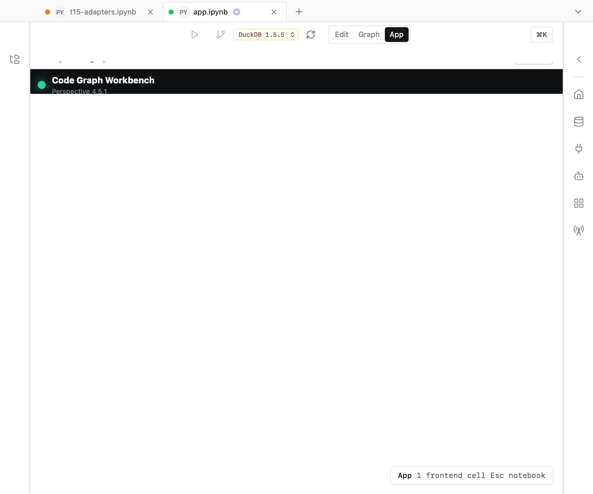

# Spur Graph Explore: rebuilt extension and human/agent experience audit

The extension rebuild is verified. **The current Explore app does not yet meet
the intended exploration and review experience.** There are reproducible
correctness and integration failures, plus missing interaction contracts.
Improving the extractor alone will not close these gaps.

This evaluation ran the existing Code Graph Workbench, its actual evidence
calls, exact provider SQL against its real database, a freshly rebuilt native
package, and adversarial ordinary-file/notebook inputs. It also inspected the
current source through graph tools and Notebook MCP. No production source fix
was made.

## Rebuild and evidence

| Check | Result |
|---|---|
| Committed build source | `52e5a972df370a989b4b557bd58350d7d67d0c5c`, isolated clean checkout |
| Native target | macOS ARM64; DuckDB exactly 2.0.0; unsigned local package |
| New package SHA256 | `41f5e65ad778a4e90d513ef5dc2f5065d0f45629968a20a231ece962e9bf627f` |
| Source identity | `source-sha256-v1:6ff57778ccc62a9cbd78f39549836fd9a7c91f55c3f94830443b239e8a17f2c2` |
| Remote Rust tests | 61 notebook core + 4 adapter passed |
| Native Python release suite | 223 passed; zero failures, errors, skips or expected failures |
| Standalone real notebook acceptance | 28 anchors, 70 original source refs, 50 symbol changes, 10 cell events; failed publication preserves prior pointer |
| Fresh notebook replay | DuckDB 2.0.0, kernel PID 78673; verified package loaded after restart |

The stable package and adjacent sidecar are under
`.spur/artifacts/explore-audit-bd-2bhj-native/`. The audit notebook is
`/Users/kevintruong/project/spur-notebook/app_gallery/code-graph-workbench/2026-11-17-spur-graph-explore-capability-audit.ipynb`.

[Raw receipts and captured source](artifacts/2026-11-17-explore-experience-audit-bd-2bhj/)
retain the successful release, first setup failure, live tool errors, notebook
outputs, screenshots and SQL identity probe. The first attempt exited 200
before compilation because an isolated `/tmp` checkout could not discover the
cloud helper. Supplying the supported `SPUR_NOTEBOOK_REPO` recovered the next
**remote** attempt. No failed compiler/test was retried locally.

The old package was not replaced. The build passing is evidence of build/API
regression checks; the new adversarial probes below demonstrate missing
coverage in those checks.

## Blocking findings measured during this audit

### 1. Ordinary-file Review invents changes on identical input

**Owner: native matcher / extension contract. Priority: P1. Issue: bd-1gyj.**

Identical before/after inputs with two definitions were tested in Python, Rust
with `cfg` alternatives, and C++ overloads. Each input extracts two symbols.
Every comparison returns **two changes: `modified` and `added`**, with an empty
diagnostics list. No source bytes changed.

The matcher maps the old inventory by `(name, kind, enclosing_scope)`, so a
duplicate overwrites another occurrence. Matching the right inventory then
consumes that single entry. See
[git_walk.rs](/Users/kevintruong/project/SpurCode/crates/spur-graph/src/git_walk.rs:2440).
The notebook matcher already has separate conservative ambiguity handling.

**Required acceptance:** identical inputs produce zero changes, or explicit
ambiguity/incomplete coverage without invented additions/modifications. Include
all three language cases, genuine duplicate edits, moves and renames. Begin
the repair with these failing regressions.

### 2. All four live evidence tools fail under the installed DuckDB 2 API

**Owner: Workbench provider/dependency compatibility. Priority: P0. Issue: bd-1kp7.**

Running the unchanged evidence cell called `wb_scorecard`, `wb_subgraph`,
`wb_blast_radius` and `wb_cochange`. All four returned:

```text
'DuckDBPyConnection' object has no attribute 'fetch_arrow_table'
```

The provider calls that method at captured
[analyst.py](artifacts/2026-11-17-explore-experience-audit-bd-2bhj/app-source/analyst.py),
line 211. Its requirements allow `duckdb>=1.0.0`, while the actual environment
has 2.0.0. None of these requests published evidence; the port manifest stayed
empty. The app's notebook runtime selector still showed 1.5.5: that selector
does not pin the separate Python MCP server's dependency environment.

The full app doctor nevertheless returned `ok: true`, level 2, and reported six
tools exposed. It verifies that the process/tool surface exists, not that a
real evidence query succeeds.

**Required acceptance:** exercise all four tools through the deployed MCP
bridge on every declared runtime. Validate actual Arrow schemas and values,
including nonempty, empty, missing-database and error cases. A readiness check
must fail when the evidence path fails.

### 3. The live App view clips the dashboard into a 40-pixel strip

**Owner: frontend/container contract. Priority: P1. Issue: bd-sl5a.**

After allowing the app's declared scripts/ports and successfully running its
frontend, the actual 960×800 window showed only the title strip. The iframe
measured **862×40**, its body reported `scrollHeight = 40`, and the fixed
dashboard inside measured **640 pixels high**. Host auto-sizing uses the body's
scroll height; the fixed layout does not contribute the required height.



**Required acceptance:** query controls, graph and inspector are reachable at
960×800, 1024×768 and a wide desktop viewport. Test actual screenshots and
keyboard/scroll access. Loading or failed initialization must present an
actionable state rather than a blank surface. The screenshot proves clipping;
it does not by itself establish a CDN/worker failure cause.

### 4. A single query resolves different symbols for different panels

**Owner: shared resolver/provider. Priority: P1. Issue: bd-3pqb.**

An isolated read-only probe executed the **exact current provider SQL**, using
`fetchall()` to bypass the broken Arrow conversion without changing provider
code. For `PortStore`:

| Panel | Primary identity | Actual target |
|---|---|---|
| Subgraph, depth 0 | `034e0783bf50a46a` | Python `PortStore` class, `sdk/python/src/spur_app/ports.py` |
| First scorecard row | `64c6c3f1b2fda943` | Rust `open_at` method, `src/dag/ports.rs` |

The topology resolves an exact candidate with `LIMIT 1`; scorecard/blast use
fuzzy matches and ranking independently. The screen can therefore combine a
graph root with another symbol's metrics. The input also matches documentation,
test helpers and multiple language definitions, with no candidate choice.

**Required acceptance:** resolve once into a canonical target, or return
disambiguation candidates. Every panel must carry the same resolved ID and
query/snapshot identity. Test duplicate names, partial queries, exact IDs,
`graph://symbol/…` URIs, files and documentation matches.

### 5. Missing data is presented as a successful empty answer

**Owner: provider result envelope and UI error handling. Priority: P1.**

In a real temporary directory without an analyst database, the underlying
Arrow table reports `workbench_status=missing_analyst_db` and recovery guidance.
`wb_query` drops that metadata, returns `ok: true`, and reports four zero-row
panels. A person or agent cannot distinguish missing setup from a genuine
answer of “no relationships.”

Initial query exceptions are swallowed before falling back to ports. During
this live run, all four ports were missing, while the visible surface did not
explain the evidence failures. Later query failures can retain earlier rows.

**Required acceptance:** preserve typed outcomes for unavailable, stale,
unsupported, partial, cancelled, failed and genuinely empty results. Retained
rows must state their original query and “last successful result.”

## The architectural gap between the extension and the app

The new extension exposes extraction and matching. Its metadata explicitly
declares **single-file** resolution. The headless consumer verifies frozen
bytes and publishes typed immutable tables, but repository/commit labels remain
caller assertions. These are useful foundations, not a repository index
lifecycle or compiler model.

The current Workbench reads an upward-discovered `.spur/analyst.duckdb` through
its older `wb_*` provider. It does not read the rebuilt package or the new
consumer's `notebook_explore` and `notebook_review` tables. In the live app,
the host displayed project `…/project/duckdb`, while the provider's actual
discovered database was `spur-notebook/.spur/analyst.duckdb`.

**Priority: P1. Issue: bd-oz9u.** Add an explicit provider boundary:

```text
human action / agent intent
  → project + snapshot + query identity
  → resolve target once
  → bounded evidence provider
  → provenance + coverage + citations + continuation
  → graph / source inspector / review / agent answer
```

Both actors need the same served repository, indexed commit or dirty overlay,
graph generation, extractor identity and result completeness. Refresh must
verify Git/path/blob provenance, preserve the previous coherent result on
failure, and distinguish old indexed facts from current source bytes.

Do not silently substitute the extension for `code_*`: repository binding and
retrieval parity are not implemented by batching single-file UDF calls.

## Native capability limits that the app must expose or address

| Capability | Fresh observation or source fact | Required behavior |
|---|---|---|
| Notebook coverage | Supported Python + unsupported cell gives graph result `ok`, but notebook symbols `partial` with `unsupported_language` | Carry document/cell coverage into every graph/provider/UI path; the existing consumer's supplement is a starting point |
| Exact references | Two `helper()` expressions become one relationship edge; returned spans cover the file and declarations | Add individually grounded call/reference site records for “show every occurrence”; keep a separate deduplicated dependency view |
| Parser recovery | Malformed Python still returns graph status `ok` with extracted facts | Expose syntax recovery separately from completed extraction and compiler validity |
| Notebook identities | Public notebook occurrence IDs intentionally differ from legacy graph IDs | Publish an explicit graph-ID ↔ notebook occurrence/SourceRef crosswalk; never join duplicate helpers by name alone |
| Review impact | Current deltas describe symbols/cells/documents, not added/removed relationships or affected callers | Show this limit; add grounded before/after relationship and impact evidence when Review requires it |
| Resource limits | Scalar extraction materializes facts before nested output; no caller admission/output/cancellation budget | Add service admission, byte/row/depth budgets, deadline/cancel outcomes and bounded publication |

The real notebook corpus still returns 46/24 symbols and 17/11 functions.
A five-run warm extraction sample of the 415,293-byte head source measured
189.05 ms median and 194.51 ms maximum on this host. This is a small local
sample, **not** a capacity, cancellation, concurrency or latency guarantee.

Confidence values describe extraction/binding evidence, not calibrated
semantic precision. Preserve unresolved labels and ambiguous candidates. The
historical November 15 parity result of 6/20 caller matches is background
evidence, not a fresh measurement of this rebuild.

## Human and agent journeys

| Intended task | Human experience today | Agent experience today | Acceptance needed |
|---|---|---|---|
| Pick repository and revision | Host project label can differ from discovered provider DB | No common scoped query envelope | Both read the same served root, revision, freshness and capabilities |
| Find a definition | Free-text form, no candidate chooser | Ambiguous text handled differently by tools | Resolve ID once; candidate list includes language/kind/path/range |
| Explore dependencies | Undirected neighborhood, no clear caller/callee mode | No consistent bounded continuation contract | Direction, unresolved counts, binding evidence, budgets and continuation |
| Inspect selected code | Name/file/kind and metrics; no source body navigation | IDs alone do not supply exact source context | Click/read original source with file/cell hashes and ranges |
| Review a change | Churn/co-change panels, no base/head review journey | New native review exists outside the app | Revision pair, honest ambiguity, source/cell/configuration deltas and impact |
| Collaborate | Human query/selection lives in iframe state | Frontend declares `emits: []`; no selection/state readback | Shared query/selection state, displayed-evidence acknowledgment and readable state tool |
| Cite or share | No reproducible saved selection/query trail | Push tools often return counts/IDs without values; file-level co-change has no symbol IDs | Bounded evidence envelopes, symbol and file citations, source opening and saved snapshot/query state |

Additional source-confirmed problems need live regression tests after the
blocking provider/render failures are repaired:

- The frontend retries `wb_query(PortStore, …)` before reading pushed ports and
  prefers a successful default result. This can replace nondefault agent
  evidence. The current live overwrite experiment was blocked by the Arrow
  failure; the finding is source-grounded, not claimed as a completed live test.
- Tapping a neighbor updates inspector name/file/kind while metrics remain
  based on the first scorecard row.
- The depth form converts `0` to the default `2` through `Number(value) || 2`.
- The renderer silently slices to 120 nodes and 260 edge rows. Provider queries
  have separate hidden limits, and recursive graph expansion lacks one common
  response budget/continuation contract.
- Edges lack arrowheads; confidence/binding evidence is not visible by default.
  “Shortest path” automatically chooses a farthest reachable target, rather
  than a user-selected destination.
- The intermediate responsive layout hides status and can place the inspector
  below a fixed, non-scrolling viewport. Keyboard graph selection is absent.

See captured [frontend source](artifacts/2026-11-17-explore-experience-audit-bd-2bhj/app-source/wb-graph.ts)
at source lines 116, 313, 376, 420 and 481. Its original notebook source was
read through Notebook MCP and remained unchanged.

## Agent/platform friction observed separately

Issue **bd-5f8w** records the knowledge pack recommending
`code_read_symbol({selector: …})`, while the actual tool requires
`stable_symbol_id` or `path` plus `name`. Following the recommendation unchanged
failed; the supported argument succeeded and disclosed stale/worktree source.

The independent audit also observed stale search returning a newly overlaid
symbol that immediate read could not find. Root's exact search returned zero,
and reading that advertised ID returned “missing from graph artifact.” This
needs a snapshot/overlay round-trip test; the precise cache cause was not
established. Neither failure belongs to the native DuckDB UDF.

The audit agent's projected tools did not expose `wb_*` directly. The app's
SDK bridge did expose them and produced the four measured failures. Agent
readiness therefore needs a deployed-agent test, not just server spawn or
tool-name checks. The bundled app skill still describes these tools as future
work and requires symbol citations even for file-only co-change evidence.

On the new audit notebook, `notebook_start_kernel(duckdb-2.0)` failed with
“unknown or conflicting kernel slot owner”; the notebook-scoped UI restart
succeeded. Runtime selection and kernel ownership need an actionable agent
contract instead of requiring a visual fallback.

## Implementation order and release gates

1. **Correctness/readiness repairs:** add the duplicate no-op regressions;
   repair the ordinary matcher; support/pin the provider Arrow API; fix App
   sizing and actionable loading/error states. Gate on real evidence queries
   and visible output, in addition to doctor/static success.
2. **One evidence contract:** explicit native/analyst provider choice,
   repository/snapshot provenance, canonical target resolution, notebook
   crosswalk, coverage/completeness, bounded evidence and citations.
3. **One human/agent session:** shared active query and selection, explicit
   inbound/outbound expansion, source opening, history, retry/cancel and agent
   readback/acknowledgment. Remove silent default-query resets.
4. **Review and scale:** base/head workflow, reliable symbol/relationship
   deltas, affected callers/tests, pagination and measured admission/cancel
   behavior on large/dense inputs.

End-to-end gates should ask a person and an agent to complete the same tasks:
choose a verified snapshot; disambiguate `PortStore`; follow a caller; open its
exact source; inspect a duplicate notebook helper; review a real change; recover
from missing/stale data; cancel a dense request; and exchange the same selected
evidence. A diagram rendering successfully is insufficient evidence that these
journeys work.

Open backlog: **bd-1gyj**, **bd-1kp7**, **bd-sl5a**, **bd-3pqb**, **bd-oz9u**,
**bd-5f8w**. Audit/rebuild tracking: **bd-2bhj**.
