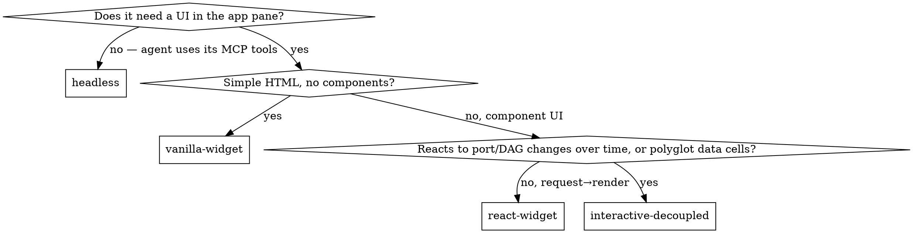

# App Archetypes — classify before you scaffold

Load this at **Step 0**, before declaring capabilities or scaffolding. Pick **one
primary archetype** and state it. The archetype decides the scaffold template, the
typical capability set, and what validation matters most. Capabilities are a *separate*
composable axis (see `capability-recipes.md`) — they are never archetypes.

## The decision rubric

## The four archetypes

| Archetype | Shape | Frontend tech | Kernels | Scaffold template |
|---|---|---|---|---|
| **`headless`** | MCP server only; the agent/user drives it via chat, no rendered UI | none | Python server | `headless` |
| **`vanilla-widget`** | App-mode HTML output; optional thin server | plain HTML/TS on **Deno** (`deno` kernelspec) | Deno (+ optional Python) | `frontend-only` (no server) · `minimal` (with server) |
| **`react-widget`** | Polished component UI calling server tools, request→render | **anywidget + React TSX** with `frontend/src` source and a thin Deno loader cell | Python server + Deno | `react-widget` |
| **`interactive-decoupled`** | Decoupled data/render; the frontend reacts to port versions via the reactive DAG | React TSX on Deno + **reactive DAG**; `source.push` emits `query`, data cells publish ports | **polyglot** — Python (`python3`), Rust (`evcxr`), Go (`gonb`) data cells write ports | `interactive-decoupled` |

`headless` is still `open_mode: "app"` — app mode is what spawns the MCP plugin. It just
has no frontend cells.

Scaffold templates are implemented in `src/spur_app/scaffold.rs`. If an archetype's
recommended structure changes, update that Rust scaffold so `notebook_app_init` produces
the ready-to-implement project layout.

## Boundary rules

- **`vanilla-widget` absorbs the old "pure render" shape.** A no-server render app is just
  `vanilla-widget` without an `mcp_server` (the existing `frontend-only` template). There
  is no separate `render-only` archetype.
- **`react-widget` vs `interactive-decoupled`:** react-widget is single-language
  (Python) request→render through `callTool`. interactive-decoupled adds **polyglot data
  cells feeding the reactive DAG**, with render decoupled from compute. The line is "does
  the frontend react to port changes over time" — see `port-state-patterns.md`.
- **React vs reactive:** React is a frontend library choice. The refresh engine is the
  reactive DAG: source-port updates schedule backend cells and render cells.

## Capability overlays are orthogonal

`ports`, `canvas_capture` (+`active_output_scripts`), and `artifacts_dir` ride on top of
*any* archetype. They are not archetypes. Declare them per `capability-recipes.md`.

## Worked examples (illustrative — confirm against each app's manifest)

| App | Reads as | Signal | Overlays |
|---|---|---|---|
| `app_gallery/open_design` | `vanilla-widget` (no server) | `mcp_server` absent | canvas_capture, artifacts_dir |
| `app_gallery/spur-growth` | `react-widget` | server + anywidget frontend | ports / artifacts as declared |
| `app_gallery/code-graph-workbench` | `react-widget` | server + `active_output_scripts` | — |
| `app_gallery/hello-world-data` | `react-widget` / `interactive-decoupled` | server + `anywidget-afm` + all four caps | ports, all four |

## Validation emphasis by archetype

- **`headless`** — `tools/list` succeeds; tool annotations accurate; *no* frontend cells.
- **`vanilla-widget`** — the frontend cell's last expression renders; no undeclared caps.
- **`react-widget`** — `callTool` round-trips; anywidget render ESM loads; returns
  partitioned (model-visible vs widget-only).
- **`interactive-decoupled`** — declared `ports.read` exist as DAG sources; port `version`
  discipline; render re-runs on upstream change without remount.

See `validation-ladder.md` for the full ladder.
