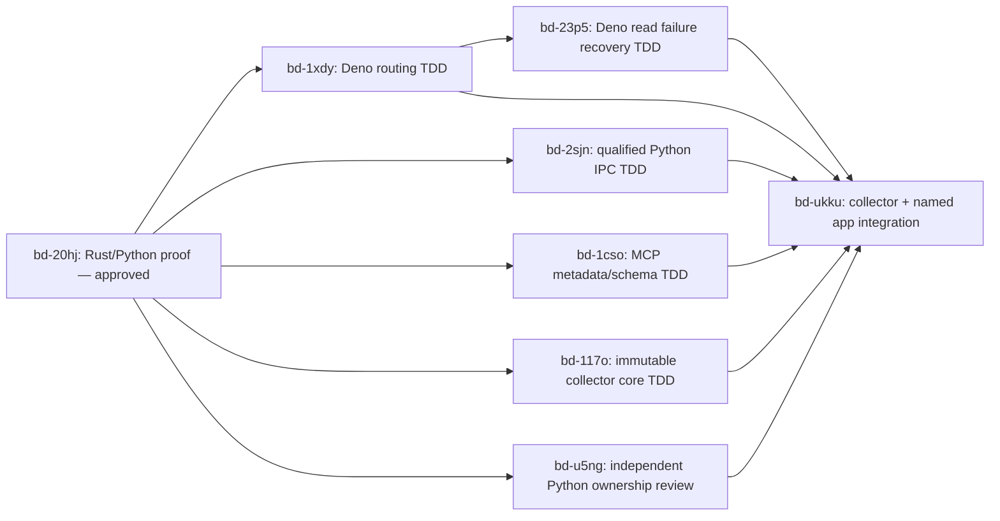

# Qualified Named Review Runtime Implementation Plan

> **For SPUR orchestrator:** Every task is beads-backed with explicit dependencies. The current MCP plan endpoint is bound to SpurCode and exposes no external-repository target; source implementation therefore uses isolated `spur-notebook` worktrees under the writable workspace and root-managed review of this same DAG.

**Source spec:** `docs/superpowers/specs/2026-11-18-qualified-named-review-runtime.md`
**Proof notebook:** `/Users/kevintruong/project/spur-notebook/2026-11-18-named-runtime-tdd-proof.ipynb`
**Grounding epic:** `bd-2gmj` (closed); **pre-TDD proof:** `bd-20hj` (closed).
**Implementation epic:** `bd-3oku`.

**Goal:** Make named Deno/Python execution and review data flow work through qualified host interfaces, preserving execution ownership and existing factory behavior.

**Architecture:** Reuse canonical native admission, process registration and host publication commit/recovery. Add Python's qualified origin carrier and wire protocol rather than transplanting the factory filesystem API. Keep the collector's immutable run contract separate from transport and UI selection.

**Tech stack:** Rust host/MCP, Jupyter/ipykernel Python, Arrow IPC, Deno project ports v2, existing DuckDB 2.0 extensions.

## Dependency graph

## D1 — named Deno routing (`bd-1xdy`)

**Depends on:** P0, approved. **Worktree:** `.spur/worktrees/review-deno-bd-1xdy`. **Scope:** `src/dag/engine.rs`, `src/mcp/tools/native_profile_lifecycle.rs`, focused adjacent tests. No Python bridge or app edits.

Write a regression using `RunCellCommandRunner::new(Arc<ServerDeps>)` and `CellRunner::ensure_kernel(KernelEnsureRequest {slot_id,spec_name})`. Valid cold named Deno should return successful deferral with no process allocated by ensure. Test lifecycle explicit/default named targets, factory None, unknown/foreign/superseded UUID and kernelspec mismatch. Observe the current rejecting path, commit tests, then add named-only deferral and optional Deno target resolution. Enumerate Deno profiles with empty factory specs. Preserve authoritative dispatch checks.

Run the new focused filter with the external repository's `scripts/spur-cargo test -p spur-notebook --lib <test-filter>`, then relevant lifecycle/selector/engine regressions. Record exact commands, exits and identities; test/fix commits remain distinct. A pure routing pass does not qualify packaged bridge startup.

## P1 — qualified Python IPC (`bd-2sjn`)

**Depends on:** P0, approved. **Worktree:** `.spur/worktrees/review-python-bd-2sjn`. **Scope:** kernel config target/runtime/startup/provenance, a Python process-registration/helper adapter, scoped wire/dispatch/admission/Running receipt, publication bridge generalization and focused tests. D1 owns only engine ensure and lifecycle resolver; P1 does not modify those regions. Any additional subsystem requires an explicit scope update.

First commit actual failing carrier/registration/fence/IPC tests. The notebook's async/thread witness must become a real existing-interpreter regression. Introduce a ContextVar origin carrier bound from host dispatch, Python registration lifetime, and Running-before-enqueue. Reuse admission/atomic commit/recovery. Extend accepted language only for a live qualified Python registration. Preserve explicit unavailable behavior and factory environment exclusion.

Test current publication and readback, late A while B runs, unbound thread, changed profile/source/generation/registration, cancellation, malformed Arrow, null/order/schema/empty batches and lost-reply recovery. Test IPython display/await/magic behavior. Run focused Rust tests via wrappers plus existing-interpreter protocol tests, then relevant native/publication regressions. Report capability qualification separately from static feature availability.

## M1 — MCP contract corrections (`bd-1cso`)

**Depends on:** P0, approved. **Worktree:** `.spur/worktrees/review-mcp-bd-1cso`. **Scope:** existing manifest-attachment vertical slice under daemon API connections, real-store regression tests, `src/mcp/tools/save.rs` schema and actual handler round-trip tests. No runtime publication files.

Create an unchanged saved connection with synthetic credentials in an injectable test store. Attach its existing manifest and assert provider/reference and credential bytes remain unchanged. Changed authenticated manifests/origins must not gain implicit reuse. Do not override HOME or use live credentials. Commit RED, preserve metadata through the existing host path, and verify GREEN plus connection regressions.

Publish a cell-object schema matching the actual save handler. Test a mixed nonempty notebook through the real handler/schema contract and retain the empty overwrite guard. Keep this test/fix history meaningful and distinct from generated schema snapshots.

## C0 — immutable collector core (`bd-117o`)

**Depends on:** P0, approved. **Scope:** new `app_gallery/spur-review` Python collector/type modules and focused tests. Accept explicit host PR receipts and prepared optional history engines. No runtime transport, notebook operations, credentials or network Git operations.

Use a real temporary Git repository to prove the tracked inventory and changed-file map. Commit RED before implementing stable content-based run identities, provider identity checks, exact base/head/context matching, evidence reference integrity and explicit partial-provider states. The notebook's real DuckDB repository proof establishes the contract; fixtures make its edge cases repeatable. Full C++ linking remains outside this task.

## D2 — Deno read failure recovery (`bd-23p5`)

**Depends on:** approved P0/D1. **Scope:** the Deno project ports v2 helper and focused actual-runtime tests. Code review found that a lost GET reply offers publication admission recovery without a request ID. Reproduce this first, then return an explicit read-unavailable failure without granting publication authority. Existing admit/commit lost-reply recovery and Arrow reads remain covered. No runtime installation or notebook operation by the worker.

## C1 — named app integration (`bd-ukku`)

**Depends on:** reviewed D1, D2, P1, PR1, M1, C0. **Worktree:** integration branch `codex/bd-3oku-integration`, created at the common source base. Remains unstarted until dependencies are reviewed.

Reuse the captured review view and current source/provider machinery. Define and test the immutable request/run packet from repository identity, PR number, pinned base/head, provider artifact identities and coverage. Add failing tests for changed-head/partial-provider/stale-response handling and exact source-ref joins before implementation. Do not turn candidate links or historical expertise into proven calls or current assignments.

Wire one real source → named Python → versioned Arrow port → named Deno frontend path. Exercise a replacement input, inspect port versions and source provenance, preserve selected review evidence and reject the older response. Activate DuckPGQ grammar on every app connection. Run static doctor after structural changes, full doctor, cascade and inspected outputs. No standalone fallback qualifies this named path, and no app pack is part of this plan.

## Integration and review gate

Independent review `bd-u5ng` inspects current P1 source with frozen hashes, then rechecks final changes and actual verification outcomes. Important findings require failing-first corrections before approval. A canceled pending enqueue must not leave an exact never-submitted run marked Running or fail a newer run.

Root reviews beads state/audits and actual diffs, then cherry-picks approved test/fix histories into the isolated integration worktree. Resolve only real overlapping runtime seams; do not discard a worker's tests. Run combined relevant regressions once after new integration changes. Build a candidate host through the remote cross-build wrapper if necessary and test it in an isolated process without replacing the installed app.

The parent epic stays active until required implementation and verification are complete. Infrastructure failures retain their exact results and do not become GREEN through local reruns. User edits in both main checkouts remain untouched.

The remote builder initially lacked Arrow/Jupyter. P1 may prepare only a task-owned remote test environment with the notebook-tested versions (`pyarrow 26.0.0`, `ipykernel 7.4.0`, `jupyter_client 8.10.0`), owned cache/temp and exact receipts. Product dependencies and shared/system interpreters remain unchanged. This explicitly replaces the original no-install worker constraint for test prerequisites only.
