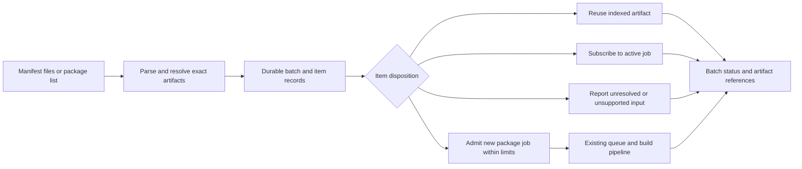

# Batch external indexing: exploration

Date: 2026-10-27. Status: proposal; no batch feature has been implemented or deployed.

## Recommendation

Add a durable batch coordinator above the existing per-package indexing queue. A user can submit dependency files or ask to index a list of packages, receive one batch ID, and inspect results per package. Each unique source artifact continues through the existing build pipeline. This preserves caching, sharing, resource limits, and independent retries.

Use direct declarations by default, with explicit options for development dependencies and transitive expansion. For `requirements.txt`, every selected requirement in the supplied file is a declaration; a frozen file may already contain transitive dependencies. Do not try to infer and remove them. This default is a design assumption pending product preference.



## Existing foundation and missing work

| Evidence in the current source | Design implication |
|---|---|
| `external_index_def`, `crates/spur-context-service/src/mcp.rs:2201`, requires one package, revision, and source URL. | A manifest/list is a new input and orchestration layer. |
| `route_index_with_dns`, `crates/spur-context-service/src/lambda.rs:445`, performs validation, warm lookup, request-rate checks, and queue admission. | Factor and reuse this control path rather than letting a batch bypass admission. |
| `canonicalize_index`, `lambda.rs:743`, recognizes crates.io URLs; generic sources default to `git:custom`. | npm/PyPI need explicit namespace, resolution, and artifact provenance handling. A generic URL fetcher is not a package resolver. |
| `enqueue_job`, `crates/spur-context-service/src/jobs.rs:1068`, uses conditional DynamoDB transactions for dedupe and quota accounting. | Keep atomic per-item admission; bulk writes cannot replace these conditions. |
| `JobKey`, `jobs.rs:122`, and `dedupe_pk`, `jobs.rs:1714`, identify source/package/revision/URL hash without an owner component. | Represent batch membership separately from a shared job. Define authorization for shared public artifacts. |
| `Drainer::drain`, `crates/spur-context-service/src/drainer.rs:179`, reconciles capacity and rotates queue shards. | Reuse dispatch; strict fairness across batches is not established by the current implementation. |
| `build_graph`, `crates/spur-context-service/src/worker.rs:2622`, invokes `spur graph build`; `crates/spur-graph/src/extract/languages.rs:329` includes Python, TypeScript, and JavaScript parsers. | The build path is reusable, but representative registry artifacts still need end-to-end coverage checks. |
| Source URL inference recognizes `.tar.gz`, `.tgz`, and `.zip` (`crates/spur-context-source/src/lib.rs:312`); worker archive naming distinguishes ZIP from gzip tar (`worker.rs:2998`). | Do not advertise wheel support based only on wheels being ZIP containers. Prefer supported source distributions initially. |

Graph retrieval reported a stale analyst/exact-graph mismatch and low semantic confidence. Bounded working-tree reads were used to check these integration points. No manifest parser or npm/PyPI resolver was found in the inspected indexing paths; this is a scoped finding, not a claim about every repository subsystem.

The source control defaults are 20 queued jobs per owner, 2 running jobs per owner, and 10 index calls per minute (`lambda.rs:172`). Deployment overrides were not read for this exploration. The existing request-rate check occurs **before** active-job deduplication: attaching to an active job avoids another build, but does not currently imply a free API request.

## Input behavior

| User input | Proposed interpretation |
|---|---|
| “Index these dependencies” plus `package.json` | Read selected dependency sections; resolve constraints to exact versions and artifact URLs. Preserve original ranges and the resolution time. |
| `package.json` plus a matching `package-lock.json` | Prefer the locked versions for selected roots; optionally expand the locked dependency instances. Preserve multiple versions of the same package. |
| `requirements.txt`, with companion requirement/constraint files | Parse requirement syntax, includes, constraints, extras, and markers. Evaluate markers against an explicit target environment when needed. |
| “Index npm react@19.0.0 and PyPI requests==2.32.3” | Convert the explicit coordinates into the same structured resolution plan. |
| An ambiguous name, missing include, private source without access, or unsupported local/workspace reference | Keep an item-level explanation and the original input location; continue independent resolvable items under the documented partial-results policy. |

`package.json` dependencies can contain version ranges, URLs, and other source forms; the parser must not assume every value is a version. A lockfile describes a concrete dependency tree. See the official [package.json reference](https://docs.npmjs.com/cli/configuring-npm/package-json/) and [package-lock.json reference](https://docs.npmjs.com/files/package-lock.json/).

pip requirement files also contain options, recursive includes, constraints, editable sources, and index configuration. Python dependency markers and extras affect selection. A line split on `==` is insufficient. See the official [requirements-file format](https://pip.pypa.io/en/stable/reference/requirements-file-format/) and [dependency specifier specification](https://packaging.python.org/en/latest/specifications/dependency-specifiers/).

Resolve manifest-only ranges according to an explicit ecosystem policy, then persist the exact result. Label it as the version selected for indexing, not the version installed in the user's project. For the initial direct-dependency mode, selecting artifacts independently does not establish that the whole set is installable together. Full transitive resolution must follow ecosystem resolver semantics and the supplied environment, rather than a custom semver or Z3 substitute.

Prefer public npm release archives and supported PyPI source archives for the first release. PyPI exposes artifact types, URLs, and digests in its [JSON API](https://docs.pypi.org/api/json/). Record unavailable source separately from a successful index. Published archives and upstream repositories are distinct artifacts: a repository URL alone does not prove which commit produced a release. Never silently substitute an upstream branch for a missing release source.

Do not install packages or execute package build hooks merely to parse the input. Metadata that cannot be resolved under the initial static policy remains explicitly unresolved. Missing referenced files must be supplied through the input bundle; they must not become arbitrary server filesystem reads.

## Proposed contract and storage

The following MCP names are proposals, not existing tools:

```json
{
  "tool": "external_index_batch",
  "arguments": {
    "packages": [
      {"ecosystem": "npm", "name": "react", "requirement": "19.0.0"},
      {"ecosystem": "pypi", "name": "requests", "requirement": "==2.32.3"}
    ],
    "include_transitive": false,
    "dry_run": false,
    "idempotency_key": "caller-supplied-key"
  }
}
```

A manifest submission uses a mutually exclusive, bounded manifest bundle with content or authorized attachment references, companion files, selected sections, and resolution context. `external_index_batch_status(batch_id, cursor)` returns summary counts and paginated items. A retry operation selects failed items from the saved resolution; cancellation stops future admission and detaches subscriptions. A dry run exposes the resolution plan without creating build work. An explicit request to index unambiguous packages can execute directly; preview is optional.

Persist these separate concepts:

1. **Batch:** caller/tenant authorization, input digest, idempotency key, options, resolution revision, lifecycle, and timestamps. Reusing a key with different input is a conflict, not silent reuse.
2. **Input occurrence:** original filename/location or list position and declared constraint. Several occurrences may refer to one resolved artifact.
3. **Batch item:** resolved identity or an unresolved declaration identity, disposition, error, attempt history, and optional job/artifact reference.
4. **Existing package job:** shared execution and artifact publication. Keep references from batch items rather than adding one exclusive `batch_id` to this job.

Resolution identity includes ecosystem, registry, canonical name, exact version or commit, source kind, and artifact provenance/digest where available. Preserve the current URL-based identity until an explicit migration is designed. Private-source identity and access must be tenant-scoped; sharing public coordinates must not expose another caller's job details. Persist credential references, not secret-bearing URLs.

The batch's ready artifacts form a collection of package/version references for retrieval. Do not merge different package versions into one indistinguishable graph. Wiring `batch_id` into retrieval filters is a separate integration requirement; the current single-package tool does not establish that capability.

## Admission, recovery, and results

The coordinator first normalizes and deduplicates within the batch. Each item then reuses a warm artifact, attaches to authorized active work, or enters bounded admission. All batches and interactive requests from an owner share the applicable limits. Define request-rate accounting separately from child-job accounting; one batch request must not buy unlimited child work.

Pending items must be durable, with explicit per-batch and per-owner backlog bounds and retention. A second unbounded backlog would defeat the existing queue cap. Resume admission on available capacity or scheduled reconciliation; do not leave an MCP call running while every package builds. Resolver metadata fetching also needs bounded concurrency and work limits.

Use the existing conditional admission transaction for each item and an idempotent batch cursor/item update. If a process crashes after enqueue but before saving the job reference, recovery must discover the existing canonical job and repair the reference. Concurrent coordinators must not double-charge admission or create two subscriptions for one item. These are implementation obligations, not properties proven by the arithmetic checks below.

Retry transient failures per package with a bounded budget and the same resolved source. Re-resolving a floating range creates a new resolution revision. Cancellation detaches this batch and stops unscheduled work; it cannot kill a job still needed by another batch. Define terminal-job reuse and retry ownership explicitly before implementation.

Expose disjoint item states, including pending resolution/admission, attached or running, ready, failed, unsupported, and cancelled. Ready can retain a provenance flag for cache reuse versus newly built work. Never count unsupported items as successfully indexed. A batch is successful only when all selected items are ready; a terminal mixture is partial, and a terminal batch with no successful items is failed. User cancellation retains its own terminal outcome and reports any completed items. Recoverable `needs_input` items require an explicit resume/expiry policy rather than an indefinitely running batch.

Track input occurrences, unique items, and ready artifacts separately. For example, 30 input occurrences may normalize into 24 items: 22 resolved artifacts and 2 unresolved declarations. If 20 become ready, 2 builds fail, and 2 inputs remain unsupported, report all 24 items and a partial outcome.

The prior deployment investigation found a Lambda-first build path and an ECS capacity strategy weighted toward Fargate Spot. A batch coordinator can reuse that path. Spot interruption classification and retry/fallback coverage must be tested explicitly; a fallback catching only `States.Timeout` is not evidence that every Spot interruption triggers on-demand fallback. A single large ECS task would couple unrelated package failures and repeat more work after interruption.

## Catalog solver evidence

Used `spurpower-solve` with catalog discovery, implemented rules, `mode: verify`, and `persist: true`. No generic formulas or dependency-resolution model were substituted for available catalog rules. Exact requests and returned verdicts are in [the solver cases](2026-10-27-batch-external-indexing-solver-cases.json); persisted receipts can be reloaded with `get_solve_result` while retained.

The resource scenario uses **illustrative occupancy**, with capacities taken from source defaults: 14/20 queued, 7/10 request/admission units used in the window, and 1/2 running. There are 12 new, cold, unique items, each requiring one admission request. It does not model warm hits, duplicate requests, global quotas, time-window rollover, or concurrent actors.

| Catalog check | Encoded case | Verdict | Solve ID |
|---|---|---|---|
| `resource.quota_capacity` | Enqueue all 12 and dispatch 2 more: 26 queued, 19 requests, 3 running | `unsat` / fail; each of the three bindings violates its limit | `sol_f62bcc9ce14b4dd2` |
| `resource.quota_capacity` | Enqueue 3 and dispatch 1 more: 17 queued, 10 requests, 2 running | `sat` / pass | `sol_b20e4491663f49e4` |
| `data_integrity.aggregate_balance` | Total 24, ready 20, failed 2, pending 0, unsupported incorrectly omitted as 0 | `unsat` / fail | `sol_d261e9b5e8634fb6` |
| `data_integrity.aggregate_balance` | Same total with unsupported 2 included | `sat` / pass | `sol_58af86c895bc4e47` |

These checks verify finite declared snapshots. They do not prove concurrent correctness, exactly-once execution, optimal scheduling, fairness, eventual completion, package compatibility, or live production behavior. The progress rule checks the sum; it does not establish that item membership is disjoint. Those properties require implementation and meaningful tests.

## Options and delivery boundary

| Option | Assessment |
|---|---|
| Client calls the existing single-package tool repeatedly | Useful prototype, but lacks durable parent status and server-side recovery; can exhaust rate limits. |
| One ECS task parses and indexes an entire manifest | Couples retries, cancellation, runtime, and memory; cannot naturally reuse per-item queue accounting. |
| Durable coordinator over existing jobs | Recommended: explicit progress, incremental admission, shared artifacts, and isolated failures. |

Start with public npm/PyPI packages, direct declarations, supported source archives, exact versions or explicitly reported range resolution, and optional npm lockfile input. Include durable status, idempotency, partial results, and per-item retry in the first usable release. Expand to transitive resolution, workspace manifests, more lockfile formats, and private registries after this path works end to end.

Before implementation, specify registry/version selection policy, supported requirement-file directives and archive formats, backlog bounds and retention, cross-batch authorization, and the retrieval collection contract. Before release, verify representative npm/Python artifact coverage, duplicate submissions, crash recovery at the enqueue/reference boundary, owner quotas across two batches, cancellation with a shared job, partial results, and Spot interruption recovery. The solver cases complement those tests; they do not replace them.
