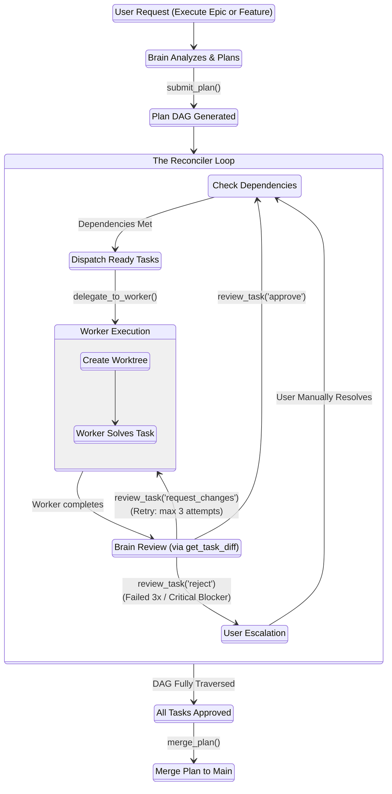
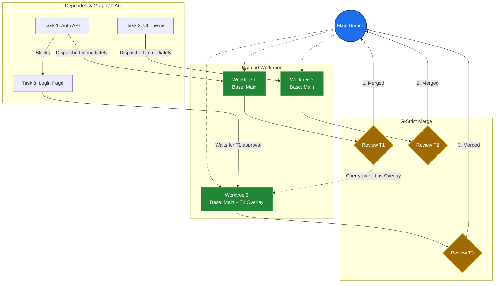
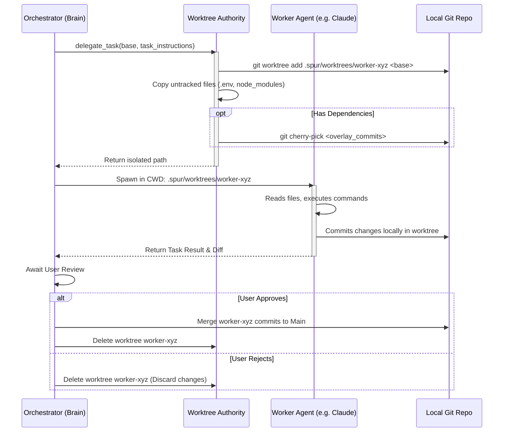

# Issues & Planning

Spur TUI provides powerful built-in tools for visualizing and managing your project's issues, dependencies, and execution plans. Rather than context-switching between your terminal and a web browser, you can inspect requirements, trace blockers, and track agent progress directly from the TUI.

## Issue Browser

The Issue Browser is your central hub for exploring tasks and epics. It synchronizes with your connected project management tracker (like GitHub, Linear, Plane, or local Beads) and displays issues alongside their metadata.

> 🎥 **Video Placeholder:** [Demonstrate opening the Issue Browser, navigating the list with j/k, and pressing Enter to open the detail view of a specific issue.]

### Navigation and Detail Views

*   **`j` / `k`** or **Up / Down**: Navigate through the list of tracked issues.
*   **`g` / `G`**: Jump to the top or bottom of the list.
*   **`Enter`**: Open the detail pane for the currently selected issue.
*   **`Esc`**: Close the detail pane (or exit the Issue Browser if no detail pane is open).
*   **`PgUp` / `PgDn`**: Scroll through long issue descriptions or large graphs.

The detail pane has two modes: **Text Mode** (which shows the description, labels, and metadata) and **Graph Mode** (which maps out dependencies).

*   **`v`**: Toggle between Text Mode and Graph Mode for the selected issue.

### Managing Work

You can trigger agent actions or update issue states directly from the browser:

*   **`W` (Work on)**: Starts a new worker session to resolve the selected issue. 
*   **`E` (Execute Epic)**: Dispatches a planner agent to execute an entire epic. This option will show a confirmation modal before kicking off the workload.
*   **`r`**: Refresh the issue list from the upstream source.

**Quick Status Updates:**
*   **`o`**: Mark as Open
*   **`w`**: Mark as In Progress
*   **`b`**: Mark as Blocked
*   **`x` / `d`**: Mark as Closed

## Issue Dependency Graphs

When you press **`v`** while viewing an issue, the TUI switches to **Graph Mode**. The graph pane visualizes the dependency tree (what the current issue blocks, or is blocked by) using a visual depth-first search (DFS) tree.

> 🎥 **Video Placeholder:** [Demonstrate pressing `v` on an issue with dependencies to switch into Graph Mode, showing the DFS tree layout.]

The tree helps you identify execution order and potential circular dependencies:

*   **Legend**: 
    *   `○` Open
    *   `●` In Progress
    *   `!` Blocked
    *   `✓` Closed
*   **Cycles**: If an issue forms a circular dependency loop, it will be marked with a `↻ cycle` indicator.

If a graph has more nodes than can fit on your screen, use `PgUp` and `PgDn` to scroll, guided by the "↓ X more dependencies" hint at the bottom.

## Plan Inspector

The Plan Inspector shows task progress, dependencies, review state, and worker output for an implementation plan.

### Board and detail panes

On wide terminals, stage lanes sit beside the selected task. Lanes show a readable window around the selected stage; the range and arrows indicate hidden stages. On narrow terminals, tasks form a stage-grouped list. Long titles show an ellipsis and leave room for priority blocker or retry information. The selected task stays visible as you navigate or resize. Very short terminals show the focused pane; use **Tab** to switch between board and detail. Compact footers keep the pane-switch or issue-return control visible.

Stages group tasks by dependency depth. Each task waits for its own prerequisites; an unrelated task in an earlier stage does not create a global stage barrier.

The header prioritizes plan status, **approved / total** progress, attention counts, and the next action. Escalated tasks count toward the total. Lifecycle counts are separate from the overlapping **deps blocked** count, and cancelled and superseded tasks have distinct counts. Press **?** to inspect the full plan ID, complete counts, source, owner, controls, and status legend.

The detail pane puts task identity, status, next action, errors, and blocker reasons before long output. Press **e** to expand or collapse execution metadata, issue context, and full relationship IDs. Selecting another task collapses this information. **Enter** opens the linked issue at its own loading state or content. Closing it restores the task's previous scroll position. Multiline output and loaded issue bodies remain scrollable.

Failed plan actions remain visible in the header, including on compact screens. Press **?** to read the full error. Unrelated loop updates do not erase it; confirming a subsequent command clears the previous error.

### Controls and focus

| Key | Action |
| --- | --- |
| **h / l**, Left / Right | Change stage |
| **j / k**, Down / Up | Select a task on the board; scroll when detail or issue has focus |
| **g / G** | First/last task in the current stage; top/bottom in a scrolling pane |
| **Tab** | Switch board/detail focus when linked issue detail is closed |
| **PgUp / PgDn** | Scroll a page in detail, issue, or help |
| **b** | Cycle the selected task's actual blockers |
| **/** | Find a task by name, task ID, or linked issue ID |
| **[ / ]** | Previous / next task needing attention |
| **p / n** | Cycle parents/children from the original task; missing external tasks show feedback |
| **e** | Expand/collapse metadata and full relationships, and focus detail |
| **Enter** | Open/close the linked issue; confirms an active confirmation dialog |
| **r / R / X** | Start or resume the plan / retry an eligible task / stop a dispatched task |
| **a / d / c** | Approve / reject / request changes for a task awaiting review |
| **s / S** | Stream peek / jump to the worker dashboard |
| **?** | Open/close scrollable help and legend, preserving the prior focus |
| **Esc** | Close help, a confirmation, stream peek, or linked issue before leaving the inspector |
| **Alt+P** | Close the inspector while browsing |

The **[focus]** marker and highlighted detail border identify the pane that owns scrolling. The footer follows the current mode. Stream peek owns **j/k** scrolling and **f** follow; **Esc** returns. Confirmation dialogs own their keys until confirmed or cancelled.

The task finder matches text without case sensitivity. Type a query, use **Up/Down** to choose a result, and press **Enter** to select it. **Backspace** removes a complete character cluster. **Esc** cancels and preserves the previous task, focus, and scroll position. Plan updates retain a chosen matching result while it still exists. Query text owns its keys, so typing **r**, **s**, or **?** does not start commands, open streams, or open help.

Attention navigation cycles through tasks awaiting review, escalated tasks, failures or rejections, setup conflicts, and current dependency blockers. Approved, cancelled, and superseded history is skipped. If no task needs attention, the inspector says so.

### Task states and metadata

| Glyph | Task state |
| --- | --- |
| ○ | Pending |
| ◐ | Ready |
| ◉ | Dispatched |
| ◈ | Awaiting review |
| ✓ | Approved |
| ⊘ | Rejected |
| ✕ | Failed |
| ⊝ | Cancelled |
| ⇢ | Superseded |
| ⦿ | Blocked on setup conflict |
| ! | Escalated to the brain |

A **BLOCKED** banner distinguishes setup conflicts from dependency waits, including conflicts with no dependency blocker IDs. Conflict output includes the reason and affected files. Worker chips show an active agent and phase; terminal executors are labeled **last worker** history. Retry chips describe attempts, while current risks omit completed retry history and deduplicate shared failed blockers. Failure ages are shown only when supported by task evidence.

## Worktree Isolation Discipline (The Spur Advantage)

A major challenge with AI coding agents is that they mutate files in your repository as they work. If you run two agents simultaneously, or try to continue your own coding while an agent is thinking, you will face file collisions, broken builds, and git conflicts.

**Spur solves this completely using automated Git Worktrees.**

Whenever the Brain orchestrator dispatches a task to a Worker agent, it does **not** run the worker in your main directory. Instead, Spur:

1. **Creates an Isolated Clone:** Automatically runs `git worktree add` to generate a temporary, hidden directory specific to that task.
2. **Synchronizes Environment:** Safely inherits untracked files (like `.env` or `node_modules`) so the worker's build environment is fully functional.
3. **Applies Overlays:** If the plan has dependencies (e.g., Task B relies on Task A), Spur cherry-picks Task A's commits into Task B's worktree *before* starting Task B.
4. **Executes in Isolation:** The worker agent (e.g., Claude Code, Codex) is "chrooted" into this directory. It is completely unaware of your main workspace.
5. **Extracts and Cleans Up:** Once the worker completes and you approve the review, Spur extracts the diff, merges the commits cleanly onto your main branch, and automatically deletes the temporary worktree.

### Why this is a Superpower
* **Massive Concurrency:** Spur can run 5 worker agents in parallel on 5 different tasks because they operate in 5 distinct directories.
* **Safe Exploration:** If a worker hallucinates and destroys the codebase, your main IDE checkout remains completely untouched. You simply reject the task in the Plan Inspector, and the tainted worktree is instantly deleted.
* **Uninterrupted Flow:** You can continue coding, running your local dev server, and pushing commits in your main directory while Spur agents work quietly in the background.

### End-to-End Plan Execution Flow (Autonomous Mode)

When you ask Spur to build a complex feature or execute an entire Epic, the Brain goes through a distinct lifecycle of planning, parallel dispatch, and continuous reconciliation. In **Autonomous Mode**, Spur attempts to resolve the entire plan with minimal human intervention.

Here is how Spur orchestrates a complete plan:

**The Plan Execution Stages:**
1. **Planning Phase:** The Brain receives your request, analyzes the requirements, and breaks the work down into a series of smaller, manageable tasks.
2. **DAG Generation:** The Brain submits these tasks to the Orchestrator via the `submit_plan` tool. Crucially, it defines the *dependencies* between these tasks, forming a Directed Acyclic Graph (DAG).
3. **The Reconciler Loop:** This is Spur's autonomous engine. It constantly evaluates the DAG. If a task has no uncompleted dependencies, the Reconciler immediately dispatches it. 
4. **Execution & Autonomous Review:** Dispatched tasks run in isolated worktrees (see below). When a worker finishes, the plan enters the review phase:
   * **The Brain Review Loop:** In Autonomous Mode, the Brain acts as the primary code reviewer. It uses the `get_task_diff` tool to inspect the worker's output. If the code looks good, it calls `review_task('approve')`, which unblocks downstream dependencies.
   * **Automated Retries:** If the code is flawed, the Brain calls `review_task('request_changes')`, providing feedback and sending the worker back to try again (up to a maximum of 3 attempts).
   * **User Escalation:** If the worker fails all 3 attempts, or if the Brain detects a severe scope drift or critical blocker, it calls `review_task('reject')`. The system pauses execution of that specific task branch and escalates to the User (you). You can manually review the failure in the TUI and intervene to unblock the flow.
5. **Final Merge:** Once the Reconciler confirms every task in the DAG is successfully approved, the Brain executes a final deterministic merge, integrating the entire feature back into your main branch.

### Graph-Strict (G-Strict) Execution & Merge Strategy

Spur achieves effective parallel execution through a **Graph-Strict (G-Strict)** dependency and merge strategy. When the Brain creates a plan, it forms a Directed Acyclic Graph (DAG) of tasks. Spur uses this DAG to perfectly orchestrate isolated worktrees and eliminate merge conflicts:

**How the G-Strict Flow Works:**
1. **Parallel Dispatch:** `Task 1` and `Task 2` have no dependencies, so Spur spawns `Worktree 1` and `Worktree 2` simultaneously. They both branch off the current `Main` commit.
2. **Overlay Application:** `Task 3` depends on `Task 1`. Spur will not dispatch `Task 3` until `Task 1` is approved. Once approved, `Worktree 3` is created, and Spur automatically applies `Task 1`'s commits as an "overlay" so the worker can build upon the new Auth API.
3. **Deterministic Merging:** By strictly honoring the graph's topological order during the merge phase, Spur guarantees that dependent tasks are always merged *after* their prerequisites. This prevents the classic "integration hell" that usually occurs when multiple developers (or AI agents) work in parallel.

### The Worker Worktree Lifecycle

To understand what exactly happens when a worker operates on a task, here is the lifecycle of a single worker session:

This sequence ensures that the worker is physically "chrooted" into its isolated environment (`CWD: .spur/worktrees/worker-xyz`). It can safely run `npm install`, compile code, or even delete files without any risk to your primary developer checkout.

## Mermaid Diagram Visualization

> 🎥 **Video Placeholder:** [Show an agent generating a Mermaid block, the placeholder transforming to the ready state, and pressing Alt-v to render the visual graph inline.]

Spur TUI natively supports **Mermaid diagrams** within issue descriptions, chat messages, and plan details. Rather than dumping raw text, Spur renders them into actual visual graphs directly inside your terminal window using a built-in rasterizer (`resvg` / `tiny-skia`).

When the TUI encounters a Mermaid code block, you'll see a placeholder while it generates:
*   `[⏳ mermaid #1 rendering…]` (In progress)
*   `[⚠ mermaid #1 error]` (Failed to parse)
*   `[📊 mermaid #1 · press Alt-v to view]` (Ready)

Once ready, press **`Alt-v`** to toggle the inline visual display of the diagram. The TUI intelligently maps the scale of the image to the layout of your terminal pane so text remains crisp and readable.
